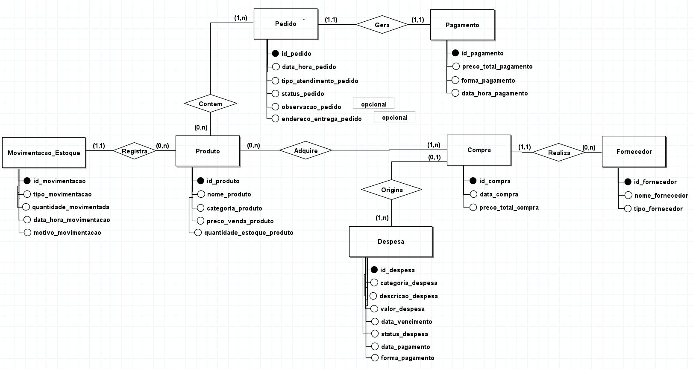
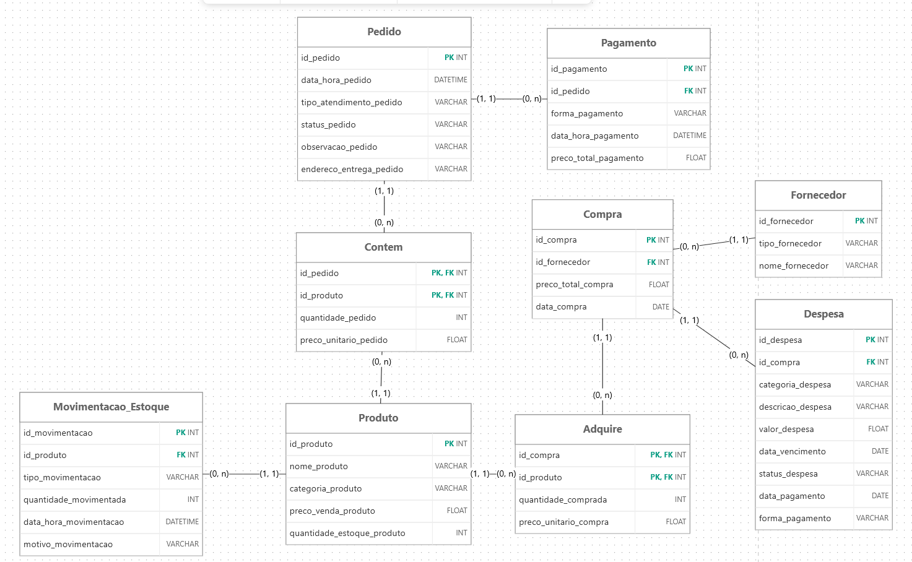

# Entrega 2 — Modelo Lógico, Implementação SQL e Apresentação Final

### Modelagem de um sistema de gestão de informações para uma organização de pequeno porte

**Organização estudada:** Bar e Restaurante Esquina dos Amigos, São Paulo/SP.

> **Critério de entrega:** este `README.md` da raiz da branch `main` é o Relatório Técnico Final. Os demais artefatos devem permanecer em arquivos próprios, referenciados neste relatório. As seções ainda não concluídas são identificadas como pendentes; nenhuma informação de campo, decisão de modelagem ou implementação SQL é presumida.

## 1. Relatório Técnico Final

### Integrantes

| Nome completo | RGM | Usuário do GitHub |
|---|---|---|
| Cauã Francisco Gomes da Silva | 47485990 | cauafgs14-ux |
| João Pedro Liberato de Oliveira | 46801375 | joaa0 |
| Marcus Vinicius dos Santos Cruz | 46690069 | Marcuss9 |
| João Vitor Gonçalves De Oliveira | 47391111 | ojoaovitor88 |

### 1.1 Revisão do Modelo Conceitual

Esta seção apresenta a revisão da **mesma organização real utilizada na Entrega 1 (Caso A do Esqueleto 2)**, tomando como referência a [Issue #1 — correção da Entrega 1](https://github.com/Marcuss9/sistema-gestao-bar-restaurante/issues/1), os registros de levantamento e os modelos existentes. Reúne a caracterização, o relato da entrevista, os processos, os requisitos, as regras de negócio, os atributos, os relacionamentos e o estado de revisão do DER conceitual.

**Documentos de apoio:** [levantamento organizado](levantamento/levantamento.md), [evidências e pendências](levantamento/evidencias.md), [perguntas e respostas originais](levantamento/fontes/perguntas-e-respostas.txt), [confirmações documentais](levantamento/fontes/confirmacoes-documentais.md) e [dicionário de dados em HTML](dicionario_dados_conceitual.html).

**Situação:** os diagramas publicados nesta branch incluem a entidade conceitual `Despesa` e a nona tabela homônima no modelo lógico, ligada a `Compra` pelo relacionamento `Origina`. `Contem` e `Adquire` permanecem relacionamentos N:N no DER sem seus atributos desenhados por decisão do grupo, o que diverge da orientação do Esqueleto 2; no lógico, são tabelas associativas com quantidade e preço. O dicionário HTML já cobre as nove tabelas; o SQL ainda precisa ser versionado e testado no MySQL. **A entrevista com Ceará, proprietário, foi realizada e documentada nas perguntas e respostas originais.** A entrevista ocorreu em **07/09/2026**, conforme confirmação do integrante. A equipe está identificada na seção Integrantes e as quatro fotos da visita já estão em `docs/imagens/`, reconhecidas na issue #1. Permanecem limitações de volumes reais não quantificados pelo proprietário, estoque mínimo (RN07), recebimentos (RN08) e validação da operação financeira.

#### Caracterização da Organização

**Nome e natureza da organização**
Bar e Restaurante Esquina dos Amigos é um estabelecimento comercial do ramo de alimentação, com aproximadamente 20 anos de funcionamento. Sua operação envolve a comercialização de refeições, porções, lanches, bebidas alcoólicas e refrigerantes, incluindo pratos especiais disponibilizados em determinados dias da semana.

**Contexto e porte**
O estabelecimento possui uma operação de pequeno porte. Em atualização documental fornecida pelo integrante em 02/11/2026, a equipe foi informada como **quatro funcionários**. A anotação original registrava três funcionários e o README anterior, quatro pessoas incluindo o proprietário; por isso, o novo número é atribuído explicitamente ao integrante e ainda requer conferência com o responsável quanto à inclusão do proprietário. Não existem funções rigidamente atribuídas aos funcionários: todos podem desempenhar as atividades necessárias de acordo com a demanda do estabelecimento, incluindo atendimento, cozinha, reposição, compras e entregas.
A operação é fortemente baseada na experiência adquirida ao longo dos anos e na familiaridade dos funcionários com o próprio comércio e com seus clientes. Dessa forma, diversas atividades são realizadas de maneira informal e sem registros estruturados, baseando-se principalmente no conhecimento dos funcionários e no acompanhamento visual da operação.
O estabelecimento trabalha com diferentes fornecedores. Entre os fornecedores recorrentes estão Ambev, Heineken e Coca-Cola, enquanto outros produtos e ingredientes são adquiridos diretamente em supermercados.

**Problemas e necessidades identificados**
O principal problema identificado está na baixa formalização dos registros operacionais e financeiros.
Atualmente, as principais informações registradas são:
* produtos que precisam ser recebidos dos fornecedores;
* gastos realizados com fornecedores;
* gastos realizados em supermercados;
* contas do estabelecimento.

Não existe um registro estruturado das vendas realizadas durante o dia. O estabelecimento também não mantém registros de mesa, nome do cliente ou número de comanda.
O controle dos produtos comercializados também não é realizado por meio de um sistema estruturado. A quantidade disponível é acompanhada de maneira visual e informal.

Os problemas passam a ser identificados para rastreabilidade documental:

| Código | Problema identificado | Requisitos relacionados | Limite atual |
|---|---|---|---|
| P1 | Ausência de registro individual das vendas e de visão dos recebimentos do dia | RF02–RF06 | `Contem` tem quantidade/preço no lógico e há consultas G01/G05/G07 no script preparado, ainda fora da `main`; atributos não desenhados no relacionamento do DER por decisão do grupo |
| P2 | Entradas e saídas financeiras dispersas entre papel e extratos | RF07, RF14 | Entidade/tabela `Despesa` agora representa obrigações pagas ou pendentes, com ou sem vínculo a `Compra`; consultas G09–G12 propostas no SQL ainda não versionado; validação operacional pendente |
| P3 | Estoque e necessidade de reposição acompanhados visualmente | RF09–RF12 | Decidido: estoque mínimo configurável e alerta por produto comercializado; falta incorporar o campo no DER/modelo lógico/dicionário e definir unidades, saldo inicial e ajustes |

Os vínculos P1–P3 com as tabelas e consultas projetadas estão identificados na seção 1.6. As consultas do SQL corrigido ainda não são artefato da branch `main`: sua disponibilidade e execução no MySQL dependem de inclusão do arquivo e teste final.

Entre as principais necessidades identificadas estão:
* visualizar quanto dinheiro foi movimentado no dia;
* acompanhar de forma mais clara o que entra e o que sai financeiramente;
* possuir maior visibilidade sobre a movimentação geral do estabelecimento;
* controlar a quantidade disponível dos produtos comercializados;
* registrar movimentações de entrada e saída do estoque.

**Volumes operacionais**
As fontes originais informam aproximadamente 20 anos de funcionamento e o integrante informou **quatro funcionários**. **Volume de clientes e movimento operacional:** segundo informação complementar transmitida pelo integrante responsável pelo levantamento em 04/11/2026, o proprietário do estabelecimento, conhecido como **“Ceará”**, **não conseguiu informar com segurança a média de clientes atendidos nem a quantidade de pedidos realizados por dia, semana ou mês**. Também não há volumes confirmados de entregas, compras por período ou produtos ativos. Assim, não existe volume real aferido ou estimado com confiabilidade para caracterizar o movimento do restaurante. A hipótese anterior de 12 pedidos/hora **não será utilizada como dado do estabelecimento**, nem como média ou pico atribuído à organização. Para a massa fictícia da Entrega 2, utilizar cenários simulados e identificá-los explicitamente como tais, sem atribuí-los à entrevista.

**Escopo do sistema e abrangência da organização**
O sistema proposto reúne cadastro e preços de produtos, pedidos presenciais e para entrega, composição dos pedidos, recebimentos, compras, fornecedores, movimentações de estoque e **obrigações financeiras** (`Despesa`: compras parceladas, contas e outros desembolsos). A venda é representada por Pedido e seus itens, sem entidade Venda separada. O modelo atual não dispõe de cadastros independentes de mesas/comandas, clientes ou funcionários, por decisões anteriores cuja justificativa ainda depende de validação.

O Esqueleto 2 exige cobertura dos dados relevantes de **toda a organização**. A inclusão de `Despesa` amplia a cobertura de P2 ao distinguir valor comprado, obrigação pendente e saída efetivamente paga; **isso não equivale a comprovação do fluxo real da organização**, pois prazos, pagamentos parciais e tipos de contas não foram validados presencialmente. A estrutura ainda não registra de forma completa **divergências na conferência dos recebimentos (RN08)** nem o **estoque mínimo/alerta (RN07)**. O controle informatizado de ingredientes da cozinha foi expressamente excluído pela RN10, sem negar que eles são adquiridos e utilizados. A delimitação do escopo deve ser justificada perante o professor e confirmada com o responsável.

**Justificativa da escolha**
O estabelecimento foi escolhido por apresentar uma operação real, de pequeno porte e com processos suficientemente definidos para a elaboração de um modelo conceitual de banco de dados.
Apesar de a operação funcionar atualmente com base na experiência dos funcionários e em controles manuais, existem diversos dados relacionados a pedidos, produtos, estoque, fornecedores, compras, pagamentos e entregas que podem ser estruturados em um sistema de gestão.
Esse cenário permite modelar uma solução que não pretende substituir a experiência dos funcionários, mas transformar informações atualmente dispersas ou não registradas em dados estruturados, possibilitando consultas e acompanhamento da operação.

**Evidências da organização**
* Fotos da Visita
  
  
  
  
* Endereço: R. Inês Monteiro, 157 - Artur Alvim, São Paulo - SP, 03568-030
* Telefone: (11) 98109-1622
* **Proprietário e responsável entrevistado: Ceará.** Ele se identifica por esse nome, conforme esclarecimento do integrante em 04/11/2026. As respostas da entrevista realizada estão em [perguntas e respostas](levantamento/fontes/perguntas-e-respostas.txt); não se presume outro nome civil.
* [Índice das evidências e lacunas de comprovação](levantamento/evidencias.md).

**Evidências existentes e alcance:** `Image01.jpeg` mostra a fachada; `Image02.jpeg`, o cardápio físico; `Image03.jpeg`, o consumo à mesa; e `Image04.jpeg`, o levantamento no balcão com notebook e cardápio semanal. A [issue #1, critério 3.2](https://github.com/Marcuss9/sistema-gestao-bar-restaurante/issues/1) reconhece a visita presencial com fotos e observa que nenhuma mostra Ceará. As fotos já estão disponíveis em formato JPEG; a extensão `.jpeg` não constitui ausência de evidência. O cardápio semanal [transcrito](levantamento/fontes/cardapio-semanal-transcricao.md) também está visível em `Image04.jpeg`. Ver [fontes e limites da conferência](levantamento/evidencias.md).

##### Relato da entrevista e fontes do levantamento

A **entrevista com Ceará, proprietário do restaurante, foi realizada em 07/09/2026**, conforme confirmação expressa do integrante nesta revisão documental de 04/11/2026. Suas respostas foram documentadas nas [anotações originais de perguntas e respostas](levantamento/fontes/perguntas-e-respostas.txt). O [levantamento organizado](levantamento/levantamento.md) sintetiza esse material, as [complementações posteriores](levantamento/fontes/confirmacoes-documentais.md) e o [cardápio semanal transcrito](levantamento/fontes/cardapio-semanal-transcricao.md). As decisões posteriores discutidas com o integrante não constituem uma segunda entrevista.

| Informação | Registro e fonte |
|---|---|
| Proprietário e entrevistado | **Ceará**, nome pelo qual se apresenta e é identificado; entrevista realizada e respostas registradas em `levantamento/fontes/perguntas-e-respostas.txt` |
| Contato do responsável | Telefone comercial informado na caracterização; contato específico a confirmar |
| Data e horário | **07/09/2026**, conforme confirmação expressa do integrante registrada em [confirmações documentais](levantamento/fontes/confirmacoes-documentais.md); horário não informado |
| Local da entrevista | Levantamento presencial do estabelecimento, na R. Inês Monteiro, 157; visita reconhecida na issue #1 e documentada em `Image01.jpeg`–`Image04.jpeg` |
| Participantes do projeto | Cauã Francisco Gomes da Silva; João Pedro Liberato de Oliveira; Marcus Vinicius dos Santos Cruz; João Vitor Gonçalves de Oliveira; nomes, RGMs e usuários na seção Integrantes e nomes na issue #1. Esses registros identificam a equipe; não discriminam a presença individual em 07/09/2026 |
| Vínculo de integrante com o estabelecimento | A declarar, se houver |
| Evidência fotográfica do levantamento | **Existente:** `docs/imagens/Image01.jpeg` a `Image04.jpeg`, já vinculadas acima; `Image04.jpeg` mostra o registro no balcão. Não se identifica Ceará nas imagens, conforme observação da issue #1 |

**Informações relatadas:** registro de pedidos em papel e comunicação verbal com a cozinha; ausência de mesa/comanda; estoque acompanhado visualmente; anotações de gastos e contas; compras com distribuidores e supermercados; entrega local e pagamento pelo cliente de transporte solicitado por aplicativo; tratamento de pedidos errados. O conteúdo detalhado, organizado por processo e com seus limites, está no levantamento Markdown.

**Observação presencial:** as imagens documentam aspectos do local (fachada e ambiente), mas as fontes não distinguem quais procedimentos os integrantes efetivamente **viram acontecer** e quais foram apenas **relatados**. Essa separação deverá ser completada pelo grupo após conferência com os participantes, sem atribuir observação direta sem evidência.

**Confirmações após a Entrega 1:** um integrante confirmou em 28/10/2026 o aceite de vale-refeição, a ausência de frete próprio e que o cliente solicita e paga o transporte por aplicativo. O limite de até dez minutos a pé é **estimativa adotada como critério do projeto**, não uma medição ou confirmação formal do responsável.

**Documentação da entrevista já realizada:** data **07/09/2026** confirmada pelo integrante; equipe identificada na seção Integrantes e na issue #1; fotos da visita já versionadas em `docs/imagens/Image01.jpeg`–`Image04.jpeg`. A entrevista realizada, a equipe identificada e as fotos existentes são reconhecidas nas respectivas fontes. Horário, presença individual e identificação das pessoas nas fotos não são inferidos. O responsável **já está identificado como Ceará**, nome com que se apresenta. Os **volumes reais de clientes e pedidos não puderam ser informados com segurança pelo proprietário**; isso é uma limitação do levantamento, não indício de entrevista não realizada. Não atribuir médias artificiais à organização.

##### Tratamento dos apontamentos da Entrega 1

Esta tabela atende ao **Caso A** do Esqueleto 2 e registra os apontamentos da [Issue #1](https://github.com/Marcuss9/sistema-gestao-bar-restaurante/issues/1), as providências efetivamente tomadas e as pendências. Uma correção do modelo lógico não é apresentada como correção do DER conceitual.

| Apontamento da correção da E1 | O que mudou no trabalho / situação | Por quê |
|---|---|---|
| **Critério 8 — regras de negócio** insuficientes e sem restrições legais, fiscais e sanitárias | **Revisão documental realizada:** RN13–RN20 acrescentadas, distinguindo práticas descritas, propostas e obrigações; validação de algumas regras continua pendente | Regras precisam ser verificáveis e relacionadas ao funcionamento e às obrigações aplicáveis |
| **Critério 9 — dicionário de dados** limitado a tabelas simples de atributos | **Atualização documental realizada:** HTML sincronizado com as **9 tabelas e 46 colunas** do modelo lógico, incluindo `Despesa` (9 colunas), PK/FK opcional, nulidade, domínios e CHECK propostos | As restrições do dicionário ainda precisam ser confrontadas com o SQL efetivamente versionado/testado; não se confundem com constraints implementadas |
| **Critério 10 — Pedido–Produto N:N sem quantidade/preço por item** | **Parcial / decisão do grupo:** `Contem` permanece um losango N:N sem esses atributos no DER; `quantidade_pedido` e `preco_unitario_pedido` estão na tabela lógica `Contem` | A conversão física preserva os itens vendidos, mas a representação conceitual difere da notação de atributos dos relacionamentos prevista no Esqueleto 2 |
| **Critério 10 — Compra–Produto N:N sem quantidade/preço por item** | **Parcial / decisão do grupo:** `Adquire` permanece um losango N:N sem esses atributos no DER; `quantidade_comprada` e `preco_unitario_compra` estão na tabela lógica `Adquire` | Preserva quantidade e custo no lógico, mas não representa esses atributos no losango conceitual conforme o esqueleto |
| **Critério 5 — processos de cardápio, recebimento, contas e reposição parcialmente descritos** | **Parcial:** descrições ampliadas com base no levantamento; horários de pratos especiais, recebimentos parciais, pagamentos de contas e critérios de reposição seguem sem validação | Evitar inventar rotinas e reconhecer dados não cobertos pelo modelo |
| **Pedido–Pagamento 1:1 impede pagamento dividido** | **Decisão de projeto RN15:** pagamento único no ato, sem fiado nem divisão; a FK `Pagamento.id_pedido` deverá ser `UNIQUE` no MySQL, mas isso não obriga todo pedido a estar pago | Manter a cardinalidade máxima e distinguir pedidos cancelados/em preparo, conforme RN14, da conclusão com pagamento |
| **Movimentações sem referência direta à origem** | **Pendente:** permanece `motivo_movimentacao` textual, sem FK para Pedido ou Compra | Rastreabilidade da operação pode exigir vínculos adicionais |
| **Cobertura de despesas, contas e desembolsos** | **Revisão gráfica:** `Despesa` incluída no DER e no lógico, com `Origina` associado a `Compra` e campos de vencimento, situação e pagamento. O SQL corrigido correspondente ainda está fora do repositório | Diferenciar compras, obrigações a pagar e saídas efetivamente pagas para P2 |
| **Documentação da entrevista e volumes operacionais** | **Entrevista realizada com Ceará**, respostas preservadas no arquivo de perguntas e respostas; data 07/09/2026 confirmada pelo integrante, equipe identificada no README e na issue #1 e quatro fotos da visita já versionadas. O proprietário não conseguiu quantificar o movimento de clientes/pedidos | Distinguir a realização do levantamento da documentação fotográfica exigida e justificar a massa fictícia sem inventar médias |

**Resultado:** o DER e o lógico foram atualizados com `Despesa`; o grupo decidiu manter `Contem` e `Adquire` apenas como **relacionamentos** no conceitual (e **tabelas** no lógico). Os atributos de quantidade e preço, ausentes dos losangos, permanecem uma **diferença em relação ao Esqueleto 2**, registrada sem afirmar atendimento integral. O dicionário já cobre nove tabelas; o SQL ainda precisa ser versionado e validado. As evidências existentes estão indexadas em `levantamento/evidencias.md`.

---

---

#### Processos de Negócio

**Principais processos mapeados**
A partir do levantamento realizado, foram identificados os seguintes processos principais:
* **PN1 — Atendimento e registro de pedidos**
* **PN2 — Preparação e entrega dos pedidos**
* **PN3 — Venda e recebimento do pagamento**
* **PN4 — Entrega de pedidos nas proximidades**
* **PN5 — Controle de produtos em estoque**
* **PN6 — Reposição, recebimento e conferência de produtos**
* **PN7 — Registro de compras**
* **PN8 — Acompanhamento financeiro**

PN1 — Atendimento e registro de pedidos O cliente realiza o pedido diretamente no estabelecimento ou, no caso de entregas, por meio do WhatsApp. No atendimento presencial, o funcionário recebe o pedido e faz uma anotação em papel, utilizada para comunicar verbalmente os itens à cozinha. Essa anotação não constitui um registro estruturado de vendas. Não são registrados número da mesa, nome do cliente ou número de comanda. Em seguida, o funcionário comunica verbalmente o pedido à cozinha. Nos pedidos destinados à entrega, o cliente informa, por meio do WhatsApp, as informações necessárias para que o pedido seja entregue.

##### Cardápio e preços

O estabelecimento possui cardápio físico com produtos e valores. Comercializa PFs, porções, lanches, pratos especiais por dia da semana, bebidas alcoólicas e refrigerantes. Uma imagem de **cardápio semanal enviada pelo integrante em 02/11/2026** traz os pratos e valores abaixo. A [transcrição integral, incluindo acompanhamentos e ressalvas](levantamento/fontes/cardapio-semanal-transcricao.md) foi registrada separadamente; a imagem original ainda precisa ser adicionada ao repositório.

| Dia indicado na imagem | Prato | PF | COM. |
|---|---|---:|---:|
| Segunda-feira | Picadinho | R$ 25,00 | R$ 40,00 |
| Terça-feira | Bife de panela | R$ 25,00 | R$ 40,00 |
| Quarta-feira | Feijoada | R$ 35,00 | R$ 70,00 |
| Quinta-feira | Frango ao molho com macarrão | R$ 25,00 | R$ 40,00 |
| Sexta-feira | Peixe com purê de batatas | R$ 35,00 | R$ 50,00 |
| Sexta-feira (segunda ocorrência) | Rabada | R$ 25,00 | R$ 40,00 |
| Sábado | Feijoada | R$ 35,00 | R$ 70,00 |

**Limites:** a fonte repete **sexta-feira** e não indica domingo; não se presume qual dia seria correto para Rabada. As colunas aparecem como **PF** e **COM.**, sem significado detalhado para “COM.”. Não há data de vigência dos valores, horário de oferta ou confirmação de disponibilidade atual. O modelo lógico contém um preço atual por Produto e ainda precisa decidir como representar as duas modalidades comerciais e a disponibilidade por dia para aplicar RN16. O preço praticado em cada item já é preservado no modelo lógico como `preco_unitario_pedido`, mas falta sua representação conceitual; o preço atual do cadastro não substitui o histórico.

##### Contas e acompanhamento dos gastos

São anotados gastos com fornecedores, supermercado e contas do estabelecimento. O fechamento relatado é mensal, com uso de extratos para comparação com os gastos. Não há registro diário individualizado das vendas.

A necessidade de visualizar entradas e saídas exige distinguir valor vendido, valor recebido, valor comprado e valor efetivamente pago. Para isso, o modelo atualizado contém `Despesa`, com valor, categoria (`compra`, `conta`, `outra`), vencimento, situação (`paga`, `pendente`) e data/forma de pagamento quando quitada. Despesas originadas de compras podem ser parcelas; contas operacionais não precisam referenciar uma compra. **Essa é a solução modelada pelo grupo, não uma descrição de controle já praticado pelo restaurante.** Critérios de parcelamento, prazos, categorias reais e conciliação continuam sujeitos à validação.

##### Pedido errado

Segundo as anotações originais, quando ocorre pedido errado, os funcionários podem consumir o prato e o estabelecimento arca com a diferença, ou o cliente pode aceitar o prato e pagar seu valor. Como **decisão para a solução**, o integrante definiu que o cancelamento comum será permitido antes do início do preparo. Isso não foi registrado como prática observada na entrevista. Estornos, autorização e diferença de valores em pratos preparados incorretamente continuam sem procedimento confirmado, conforme RN14.

##### Limites e processos a confirmar

A ausência de mesa/comanda e de cargos fixos está relatada. A exclusão de cadastros permanentes de clientes e funcionários permanece uma decisão do modelo atual. O integrante reafirmou a **exclusão de ingredientes do controle de estoque** na RN10; não se conclui com isso que os processos de compra e preparo desses ingredientes não existam. A equipe deverá justificar a delimitação perante a exigência de cobertura da Entrega 2.

Escalas, validade de alimentos, rotina fiscal e detalhes do fechamento não estão confirmados nas fontes. **Para o projeto**, a RN15 já exclui pagamento posterior/fiado e divisão entre modalidades, mas o instante exato da cobrança (antes ou depois do preparo) ainda precisa ser confirmado no estabelecimento. Não há evidência de necessidade de QR Code, recomendação automática ou outro canal de venda adicional.

**Fluxogramas**
* 

---

---

#### Requisitos do Sistema

##### Requisitos Funcionais

Os requisitos descrevem a solução proposta, não funcionalidades implantadas. Os códigos são preservados; os campos abaixo usam o vocabulário atual, com dependências do modelo explicitadas.

* **RF01 — Cadastrar produtos:** Registrar identificador, nome, categoria, preço atual de venda, saldo e **estoque mínimo configurável** de cada produto comercializado sujeito a controle. Ingredientes de cozinha permanecem fora do escopo (RN10). O campo de estoque mínimo ainda precisa ser incorporado ao modelo e ao dicionário; categorias e unidades devem ser validadas.
* **RF02 — Registrar pedidos:** Registrar identificador único, data/hora, tipo de atendimento, situação e observação opcional; para entrega, registrar endereço. A solução deve distinguir pedido ainda não iniciado na cozinha de pedido em preparo, para aplicar a RN14; os estados e sua representação no modelo precisam ser definidos.
* **RF03 — Registrar os itens de um pedido:** Associar um ou mais produtos ao pedido, com quantidade e preço unitário praticado. `Contem` representa o relacionamento N:N no DER e vira tabela associativa com esses atributos no lógico; o grupo optou por não desenhá-los como atributos do losango conceitual.
* **RF04 — Registrar a forma de pagamento:** Registrar identificador, valor recebido, uma única modalidade (dinheiro, crédito, débito, vale-refeição ou Pix) e data/hora, associado ao pedido. A RN15 define pagamento no ato, sem fiado nem divisão; a equipe técnica deve tratar pedidos cancelados antes de pagamento e o momento exato da cobrança.
* **RF05 — Registrar vendas:** Identificar a operação comercial pelo Pedido e seus itens, preservando quantidade e preço praticado, e relacionar os recebimentos. Não confundir valor vendido com valor recebido.
* **RF06 — Consultar movimentação diária:** Consultar valores recebidos por data e forma de pagamento, utilizando valor e data/hora de Pagamento. A data de venda utiliza Pedido e deve ser distinguida da data de recebimento.
* **RF07 — Registrar compras:** Registrar identificador, fornecedor, data e valor total, com produtos, quantidades e preços de aquisição por item. `Adquire` permanece como relacionamento N:N no DER e recebe esses atributos na tabela associativa lógica; `Compra` pode originar obrigações registradas em `Despesa`.
* **RF08 — Registrar fornecedores:** Registrar identificador, nome e classificação do fornecedor, incluindo distribuidores recorrentes e supermercados; o domínio da classificação deve ser validado.
* **RF09 — Acompanhar necessidade de abastecimento:** Cadastrar e consultar o estoque mínimo de cada produto controlado, comparar com o saldo disponível e **alertar quando o saldo for menor ou igual ao mínimo** (RN07). O processo atual é visual; o parâmetro e o alerta são decisões do sistema proposto, ainda não refletidas integralmente no modelo lógico.
* **RF10 — Registrar recebimento de produtos:** Registrar produto, quantidade esperada, quantidade efetivamente recebida, diferença identificada, data e referência à compra/documento para conferência e resolução junto ao fornecedor (RN08). A forma de registrar entregas parciais/devoluções e os vínculos no modelo ainda dependem da equipe técnica e validação operacional.
* **RF11 — Registrar movimentações de estoque:** Registrar identificador, produto, entrada/saída, quantidade positiva, data/hora e motivo. A origem em venda, compra, perda ou ajuste deve ter sua representação definida pela equipe.
* **RF12 — Consultar informações de estoque:** Consultar saldo por produto e histórico de entradas/saídas com quantidade, data/hora e motivo. A conciliação exige definir saldo inicial e unidades.
* **RF13 — Registrar pedidos para entrega:** Identificar o tipo de atendimento e o endereço do pedido, respeitando a área adotada na RN03, a entrega local sem frete da RN12 e o transporte contratado pelo cliente da RN05. A representação da modalidade de retirada/entrega precisa ser alinhada ao modelo.
* **RF14 — Consultar entradas e saídas financeiras:** Consultar recebimentos (`Pagamento`) e desembolsos/obrigações (`Despesa`) por período, separando compras, contas, parcelas pagas e pendentes. O novo vínculo opcional `Despesa.id_compra` permite associar parcelas a compras; fluxos G09–G12 estão previstos no SQL corrigido ainda não versionado na `main`. Não confundir fluxo de caixa líquido com lucro contábil.

##### Requisitos Não Funcionais
Os seguintes requisitos são propostos para a solução, não constituindo características atualmente observadas na organização:
* **RNF01 — Usabilidade:** O sistema deve possuir uma interface simples, considerando que a operação atual é realizada de maneira informal e sem um sistema de gestão estruturado.
* **RNF02 — Disponibilidade:** O sistema deve estar disponível durante o período de funcionamento do estabelecimento para permitir o registro das operações.
* **RNF03 — Integridade dos dados:** Os registros devem manter consistência entre pedidos, produtos, pagamentos, compras, estoque e movimentações financeiras.
* **RNF04 — Segurança:** O acesso aos dados administrativos, financeiros e pessoais deve depender de autenticação e permissões por perfil de acesso, sem exigir vínculo obrigatório de cada operação a uma entidade Funcionário (RN11); os perfis ainda precisam ser definidos.
* **RNF05 — Desempenho:** O sistema deve responder às operações de cadastro, consulta e registro das operações cotidianas em até 3 segundos em condições normais de uso.
* **RNF06 — Manutenibilidade:** O sistema deve ser estruturado de forma organizada, permitindo a manutenção e evolução de suas funcionalidades sem comprometer os dados já registrados.

**Critérios de conferência dos RNF**

| Código | Como conferir / decisão necessária |
|---|---|
| RNF01 | Validar com representante da operação as tarefas de registrar pedido, recebimento e consulta diária; participantes, roteiro e critério de aceitação ainda devem ser definidos |
| RNF02 | Confirmar dias/horários de funcionamento e meta de disponibilidade antes da avaliação |
| RNF03 | Conferir referências, obrigatoriedade, domínios, totais e consistência de estoque no modelo e nas consultas de auditoria |
| RNF04 | Definir perfis e conferir operações permitidas/negadas, especialmente endereço de entrega e informações financeiras |
| RNF05 | Manter 3 segundos como meta proposta; definir volume, equipamento, concorrência e consultas antes de medir |
| RNF06 | Conferir consistência entre README, dicionário e modelos, e documentar alterações; resta definir procedimento de evolução do banco |

---

---

#### Regras de Negócio

As regras a seguir estão separadas em **regras operacionais**, **regras propostas que dependem de validação** e **restrições legais, sanitárias, fiscais e de privacidade**. Propostas não devem ser confundidas com práticas confirmadas na entrevista. A presente atualização textual não modifica o arquivo gráfico do DER, cuja revisão está indicada adiante.

##### Regras operacionais e de escopo

* **RN01 — Formas de pagamento:** As vendas podem ser pagas em dinheiro, cartão de crédito, cartão de débito, vale-refeição ou Pix. O registro de cada pagamento deve indicar uma das modalidades aceitas.
* **RN02 — Execução das atividades:** As atividades de atendimento, preparo, compras, reposição e entregas podem ser desempenhadas pelos funcionários conforme a demanda, sem exigência de cargo fixo para cada operação.
* **RN03 — Área de entrega:** O restaurante realiza entregas próprias apenas nas proximidades do estabelecimento. Para o projeto, adota-se o limite de até dez minutos de trajeto a pé a partir da R. Inês Monteiro, 157, Parque Arthur Alvim. O critério decorre de estimativa aceita pelo integrante responsável pela revisão em 28/10/2026; não corresponde a um raio medido nem a uma confirmação de campo.
* **RN04 — Entrega a pé:** As entregas locais podem ser realizadas a pé por qualquer funcionário, sem a designação obrigatória de um entregador exclusivo.
* **RN05 — Transporte por aplicativo:** Quando houver transporte por aplicativo para retirada do pedido, o próprio cliente solicita o serviço e paga o transporte. O restaurante não é responsável por contratar esse transporte, conforme anotações originais e confirmação complementar do integrante.
* **RN06 — Identificação do fornecedor:** Toda compra registrada deve identificar seu fornecedor, inclusive quando realizada em supermercado, sem limitar o cadastro a uma lista fixa de empresas.
* **RN07 — Reposição de estoque:** Hoje a necessidade de reposição é identificada visualmente, inclusive pelo último pacote. **Decisão do projeto (02/11/2026):** cada produto comercializado sob controle deverá ter estoque mínimo configurável, e o sistema alertará quando o saldo registrado for menor ou igual a esse mínimo. A definição dos valores iniciais, unidades e o acréscimo do atributo ao modelo/dicionário permanecem pendentes; não há entidade própria de Reposição.
* **RN08 — Conferência do recebimento:** A rotina relatada compara o caderno com a nota do fornecedor. **Decisão do projeto (02/11/2026):** registrar as quantidades esperadas e recebidas, identificar divergências e mantê-las documentadas para resolução com o fornecedor. Devoluções, entregas parciais e como cada diferença afeta a entrada de estoque continuam pendentes de detalhamento; não se presume bloqueio automático.
* **RN09 — Identificação do pedido:** Cada pedido registrado deve possuir identificador único, sem exigir identificação de mesa, comanda ou cadastro de cliente, pois tais controles não integram a operação modelada.
* **RN10 — Limite do controle de estoque:** O estoque estruturado abrangerá **somente produtos comercializados sob controle**, sem cadastrar ou movimentar ingredientes da cozinha. A delimitação original foi reafirmada pelo integrante em 02/11/2026; compras e gastos com ingredientes continuam relevantes para os registros financeiros, sem exigir controle de quantidade por insumo.
* **RN11 — Identificação do funcionário e acesso:** Por decisão do projeto (02/11/2026), pedidos, compras e movimentações não exigirão a identificação do funcionário executor em cada registro, nem entidade Funcionário no modelo conceitual atual. O acesso ao sistema, porém, dependerá de perfis e permissões; forma de autenticação, papéis e eventual identificação técnica de sessão ainda devem ser definidos (RNF04/RN20).
* **RN12 — Cobrança de entrega:** O restaurante não cobra frete próprio nas entregas locais. O custo do transporte por aplicativo solicitado pelo cliente, previsto na RN05, não corresponde a frete cobrado pelo estabelecimento.

##### Exceções, regras propostas e decisões pendentes

A RN13 continua proposta e a RN16 possui **cardápio semanal documental**, com duas entradas de sexta-feira e sem informação sobre vigência ou horários. As **RN14 e RN15 foram definidas como decisões do projeto em 02/11/2026**, sem comprovação de uma nova entrevista: cancelamento somente antes de iniciar o preparo e pagamento no ato, único, sem fiado ou divisão. Detalhes de estorno e do procedimento para pedido preparado incorretamente permanecem pendentes.

* **RN13 — Venda com estoque insuficiente (proposta):** Para produtos controlados em estoque, a confirmação de uma venda não deverá gerar saldo negativo. Quantidades insuficientes deverão ser revisadas; o tratamento de exceções e diferenças entre saldo físico e registrado depende de validação com o estabelecimento.
* **RN14 — Pedido errado, cancelamento ou troca:** O relato original informa que, diante de prato preparado incorretamente, os funcionários podem consumi-lo e o estabelecimento arca com a diferença, ou o cliente aceita o prato e paga seu valor. **Decisão do projeto (02/11/2026):** o cancelamento comum de pedido é permitido **somente antes do início do preparo**, com registro da ocorrência e preservação do histórico. A exceção de prato errado não é tratada automaticamente como cancelamento comum. Estornos, autorizações, diferenças de valores e efeito no estoque dependem de regras complementares.
* **RN15 — Pagamento único e no ato (decisão do projeto):** Para a solução proposta, o pagamento deverá ser realizado no ato da operação, em **uma única modalidade por pedido**, sem fiado, parcelamento interno ou divisão entre formas de pagamento. A informação é decisão do integrante em 02/11/2026, não confirmação registrada em entrevista. O momento exato em relação ao preparo e o tratamento de pedidos cancelados antes de pagar ou já pagos ainda exigem definição; a equipe deve conferir a correspondência com a cardinalidade Pedido–Pagamento.
* **RN16 — Pratos especiais por dia:** O sistema deverá respeitar a oferta anunciada por dia no [cardápio semanal fornecido pelo integrante](levantamento/fontes/cardapio-semanal-transcricao.md), preservando pratos e preços como dados documentais sem vigência confirmada. A imagem contém **duas ocorrências de sexta-feira** (peixe com purê e rabada); não se pode decidir que uma delas corresponde a outro dia. O horário da oferta, o significado de “COM.” e o procedimento de atualização de preços/disponibilidade ainda precisam de validação. O modelo lógico atual não dispõe de atributo próprio para dia ou variante de preço, exigindo decisão dos responsáveis técnicos antes de automatizar a RN16.

##### Restrições legais, sanitárias, fiscais e de privacidade

As obrigações abaixo decorrem das normas aplicáveis ao estabelecimento; sua documentação não significa que as funcionalidades correspondentes já estejam implementadas.

* **RN17 — Proibição de venda de bebidas alcoólicas a menores:** É proibido vender, fornecer ou servir bebidas alcoólicas a crianças ou adolescentes, nos termos dos arts. 81, II, e 243 do Estatuto da Criança e do Adolescente (Lei nº 8.069/1990).
* **RN18 — Boas práticas sanitárias:** A manipulação, preparação, conservação, armazenamento e validade dos alimentos devem observar as normas sanitárias aplicáveis a serviços de alimentação, incluindo a RDC Anvisa nº 216/2004 e regras locais pertinentes. A ausência de controle informatizado dos ingredientes não afasta essas obrigações.
* **RN19 — Documentação fiscal:** As vendas devem cumprir as obrigações de documentação fiscal aplicáveis, incluindo a emissão de NFC-e no varejo paulista quando exigida, e as compras devem respeitar a documentação fiscal pertinente. Esta regra não pressupõe a implementação de um módulo fiscal nesta entrega.
* **RN20 — Proteção de dados e controle de acesso:** As informações pessoais necessárias para entregas devem ser tratadas somente para finalidades legítimas, com coleta limitada ao necessário e acesso autorizado. Informações administrativas e financeiras devem ter acesso restrito, em consonância com a LGPD (Lei nº 13.709/2018) e o RNF04.

##### Restrições organizacionais e decisões de escopo

O integrante informou **quatro funcionários** em 02/11/2026 (as anotações anteriores diziam três e o README antigo, quatro pessoas incluindo o proprietário); resta confirmar com o responsável se o proprietário está incluído nessa contagem. O estabelecimento utiliza processos predominantemente informais, com dependência da experiência da equipe. Essas características contextualizam o projeto, **mas não substituem regras operacionais verificáveis**.

Por decisões de escopo, a modelagem desta entrega não prevê cadastro independente de Cliente ou Funcionário, identificação por mesa ou comanda, controle estruturado de ingredientes (RN10) nem entidade própria de Reposição. Os perfis de acesso da RN11 não exigem atribuir um funcionário executor a cada pedido. Pedido representa a operação comercial, mantendo o escopo de registros de pedidos, pagamentos, compras, fornecedores e movimentações dos produtos controlados em estoque.

---

---

#### Dicionário de Dados Conceitual

Consulte o [Dicionário de Dados HTML da Entrega 2](dicionario_dados_conceitual.html), **atualizado para as 9 tabelas e 46 colunas** do modelo lógico vigente. A seção `Despesa` documenta suas 9 colunas, a FK opcional `id_compra`, nulidade, chaves, domínios, `CHECK` propostos, `UNIQUE` e ausência de valores padrão presumidos. Os valores monetários são representados como `FLOAT` no brModelo e descritos como `DECIMAL(12,2)` para o SQL MySQL. As tabelas abaixo sintetizam **as sete entidades conceituais** do DER; não substituem o dicionário HTML relacional. **Essa documentação não comprova a execução das restrições no banco.**

##### Produto
| Atributo | Descrição | Regra de negócio associada |
|----------|-----------|------------------------------|
| id_produto | Identificador único do produto | Deve identificar exclusivamente cada produto |
| nome_produto | Nome do produto | Obrigatório |
| categoria_produto | Categoria do produto | Deve permitir classificar o produto |
| preco_venda_produto | Preço praticado na venda do produto | Deve representar o preço atual |
| quantidade_estoque_produto | Quantidade atualmente disponível em estoque | Deve representar o saldo atualizado do produto |

##### Pedido
| Atributo | Descrição | Regra de negócio associada |
|----------|-----------|------------------------------|
| id_pedido | Identificador único do pedido | Deve identificar exclusivamente cada pedido |
| data_hora_pedido | Data e horário em que o pedido foi feito | Obrigatório |
| tipo_atendimento_pedido | Identifica atendimento presencial ou entrega | Deve permitir diferenciar os tipos de atendimento |
| status_pedido | Situação atual do pedido | Deve representar o andamento do pedido |
| observacao_pedido | Informações adicionais do pedido | Opcional |
| endereco_entrega_pedido | Local informado para pedidos de entrega | Obrigatório quando o pedido for destinado à entrega |

##### Pagamento
| Atributo | Descrição | Regra de negócio associada |
|----------|-----------|------------------------------|
| id_pagamento | Identificador único do pagamento | Deve identificar exclusivamente o pagamento |
| preco_total_pagamento | Preço/montante pago | Deve corresponder ao montante da operação |
| forma_pagamento | Forma utilizada no pagamento | Dinheiro, crédito, débito, vale refeição ou Pix |
| data_hora_pagamento | Momento em que o pagamento foi realizado | Obrigatório |

##### Fornecedor
| Atributo | Descrição | Regra de negócio associada |
|----------|-----------|------------------------------|
| id_fornecedor | Identificador único do fornecedor | Deve identificar exclusivamente o fornecedor |
| nome_fornecedor | Nome do fornecedor | Obrigatório |
| tipo_fornecedor | Classificação do fornecedor | Pode distinguir fornecedor recorrente de supermercado |

##### Compra
| Atributo | Descrição | Regra de negócio associada |
|----------|-----------|------------------------------|
| id_compra | Identificador único da compra | Deve identificar exclusivamente a compra |
| data_compra | Data de realização da compra | Obrigatório |
| preco_total_compra | Preço total da compra | Deve corresponder à soma dos itens adquiridos |

A referência ao fornecedor da compra aparece no **modelo lógico** em `Compra.id_fornecedor`; no DER conceitual, é expressa pelo relacionamento Compra–Fornecedor, sem FK desenhada na entidade. Da mesma forma, `id_compra` é uma FK **opcional** em `Despesa` somente no modelo lógico.

##### Movimentacao_Estoque
| Atributo | Descrição | Regra de negócio associada |
|----------|-----------|------------------------------|
| id_movimentacao | Identificador único da movimentação | Deve identificar exclusivamente o registro |
| tipo_movimentacao | Tipo de movimentação (Entrada ou Saída) | Deve especificar se o estoque aumentou ou diminuiu |
| quantidade_movimentada | Quantidade de itens movimentados | Deve ser positiva |
| data_hora_movimentacao | Data e horário da movimentação | Obrigatório |
| motivo_movimentacao | Motivo da entrada ou saída | Ex: Compra, Venda, Perda, Ajuste |

##### Despesa
| Atributo | Descrição | Regra / restrição proposta |
|---|---|---|
| id_despesa | Identificador da obrigação financeira | Identificador único |
| categoria_despesa | Tipo de obrigação: compra, conta ou outra | Classificação por origem |
| descricao_despesa | Descrição da parcela ou conta | Obrigatória |
| valor_despesa | Valor da obrigação | Positivo |
| data_vencimento | Vencimento da obrigação | Obrigatório |
| status_despesa | Situação financeira | Paga ou pendente |
| data_pagamento | Data da quitação | Apenas quando paga |
| forma_pagamento | Modalidade usada na quitação | Apenas quando paga |

O vínculo conceitual com `Compra` é o relacionamento `Origina`; sua FK opcional `id_compra` aparece apenas no modelo lógico. A obrigação pode ser parcela de compra ou conta não vinculada a compra. A associação conceitual prevê uma ou mais despesas por compra, sujeita a validação de integridade além da FK.

---

---

#### Modelagem Conceitual (Entidades, Atributos e Relacionamentos)

A modelagem conceitual foi elaborada a partir dos processos de negócio, requisitos, regras de negócio e do Dicionário de Dados Conceitual definidos para o **Bar e Restaurante Esquina dos Amigos**.

O objetivo desta etapa é representar, de forma independente da implementação física do banco de dados, as principais entidades necessárias ao sistema, seus atributos, relacionamentos, cardinalidades e restrições organizacionais.

##### Entidades reconhecidas

A partir do levantamento realizado e das necessidades identificadas no estabelecimento, foram reconhecidas as seguintes entidades:

- **Produto:** representa os produtos comercializados pelo estabelecimento e controlados em estoque.

- **Pedido:** representa uma solicitação de produtos realizada por um cliente. No modelo proposto, o Pedido corresponde à operação comercial registrada pelo sistema, não sendo necessária uma entidade Venda separada.

- **Pagamento:** representa o recebimento associado a um pedido, armazenando as informações referentes ao valor, forma e momento do pagamento.

- **Fornecedor:** representa empresas, supermercados ou outros estabelecimentos responsáveis pelo fornecimento de produtos ao restaurante.

- **Compra:** representa uma aquisição de produtos realizada pelo estabelecimento junto a um fornecedor.

- **Movimentacao_Estoque:** representa os registros de entrada e saída dos produtos, permitindo acompanhar e justificar as alterações ocorridas no estoque.

- **Despesa:** representa obrigações financeiras do estabelecimento, pagas ou pendentes, como parcelas de compras, contas e outros desembolsos.

As entidades **Cliente** e **Funcionario** não foram incluídas no modelo conceitual por decisão de escopo anterior. O anexo relata ausência de nome do cliente nos pedidos e de cargos fixos; a dispensa de cadastro permanente e de identificação de executor precisa ter sua justificativa validada. Nos pedidos destinados à entrega, as informações necessárias são registradas diretamente no próprio Pedido.

Também não foi criada uma entidade **Venda**, pois o Pedido já representa a operação comercial realizada pelo estabelecimento.

Os relacionamentos `Contem` (Pedido–Produto) e `Adquire` (Compra–Produto) continuam como losangos N:N no DER conceitual. **Por decisão do grupo, os atributos de quantidade e preço não serão desenhados nesses losangos**; no lógico, surgem nas tabelas associativas homônimas, equivalentes a estruturas de itens. Essa distinção não deve ser confundida com conformidade integral à notação solicitada pelo Esqueleto 2. O relacionamento `Origina` liga `Compra` a `Despesa` no conceitual.

##### Atributos e classificações

Os atributos definidos para cada entidade são:

| Entidade | Atributos |
|---|---|
| **Produto** | `id_produto`, `nome_produto`, `categoria_produto`, `preco_venda_produto`, `quantidade_estoque_produto` |
| **Pedido** | `id_pedido`, `data_hora_pedido`, `tipo_atendimento_pedido`, `status_pedido`, `observacao_pedido`, `endereco_entrega_pedido` |
| **Pagamento** | `id_pagamento`, `preco_total_pagamento`, `forma_pagamento`, `data_hora_pagamento` |
| **Fornecedor** | `id_fornecedor`, `nome_fornecedor`, `tipo_fornecedor` |
| **Compra** | `id_compra`, `data_compra`, `preco_total_compra` |
| **Movimentacao_Estoque** | `id_movimentacao`, `tipo_movimentacao`, `quantidade_movimentada`, `data_hora_movimentacao`, `motivo_movimentacao` |
| **Despesa** | `id_despesa`, `categoria_despesa`, `descricao_despesa`, `valor_despesa`, `data_vencimento`, `status_despesa`, `data_pagamento`, `forma_pagamento` |

Os identificadores iniciados por `id_` identificam as entidades. Os relacionamentos conceituais são convertidos em chaves estrangeiras apenas no modelo lógico.

**Atributos de itens representados somente no modelo lógico, por decisão do grupo:**

| Relacionamento do DER | Tabela lógica gerada | Atributos próprios da associação |
|---|---|---|
| Pedido — **Contem** — Produto | `Contem` | `quantidade_pedido`, `preco_unitario_pedido` |
| Compra — **Adquire** — Produto | `Adquire` | `quantidade_comprada`, `preco_unitario_compra` |

O grupo decidiu manter os losangos sem esses atributos gráficos; isso **não satisfaz integralmente** a indicação do Esqueleto 2 de ligar atributos de relacionamentos aos losangos (ou usar entidade associativa adequada). A documentação explicita a decisão sem alterar o arquivo de imagem nem desenhar FKs no DER.

No Pedido, `observacao_pedido` é opcional, pois nem todo pedido necessita de uma observação adicional. O atributo `endereco_entrega_pedido` também é opcional, sendo necessário apenas quando o tipo de atendimento corresponder a uma entrega.

Os demais atributos representam informações necessárias para caracterizar e acompanhar cada ocorrência das entidades dentro dos processos do estabelecimento.

##### Relacionamentos pertinentes

As entidades estão conectadas pelos seguintes relacionamentos:

###### Produto — Movimentacao_Estoque

Um **Produto pode possuir nenhuma ou várias Movimentações de Estoque**, enquanto cada **Movimentacao_Estoque está relacionada a exatamente um Produto**.

**Cardinalidade:**

- Produto: `(0,n)`
- Movimentacao_Estoque: `(1,1)`

Esse relacionamento permite registrar e acompanhar as entradas e saídas relacionadas a cada produto.

###### Pedido — Produto

Um **Pedido contém um ou vários Produtos**, enquanto um Produto pode estar presente em nenhum ou em vários Pedidos.

**Cardinalidade:**

- Pedido: `(1,n)`
- Produto: `(0,n)`

É um relacionamento **N:N**. O grupo mantém o losango `Contem` sem atributos gráficos; quantidade e preço unitário estão na tabela lógica, com a ressalva de notação do Esqueleto 2.

###### Pedido — Pagamento

Um **Pedido gera exatamente um Pagamento**, e cada Pagamento está relacionado a exatamente um Pedido.

**Cardinalidade:**

- Pedido: `(1,1)`
- Pagamento: `(1,1)`

Esse relacionamento representa o pagamento correspondente à operação comercial registrada pelo pedido.

###### Compra — Produto

Uma **Compra adquire um ou vários Produtos**, enquanto um Produto pode estar presente em nenhuma ou em várias Compras.

**Cardinalidade:**

- Compra: `(1,n)`
- Produto: `(0,n)`

É um relacionamento **N:N**. O grupo mantém o losango `Adquire` sem atributos gráficos; quantidade e custo unitário estão na tabela lógica, com a ressalva de notação do Esqueleto 2.

###### Fornecedor — Compra

Um **Fornecedor pode estar relacionado a nenhuma ou várias Compras**, enquanto cada Compra está relacionada a exatamente um Fornecedor.

**Cardinalidade:**

- Fornecedor: `(0,n)`
- Compra: `(1,1)`

Esse relacionamento permite identificar o fornecedor responsável por cada aquisição realizada pelo estabelecimento.

###### Compra — Despesa (Origina)

Uma **Compra pode originar uma ou mais Despesas**, correspondentes às parcelas ou obrigações financeiras previstas; uma **Despesa pode corresponder a nenhuma ou a uma Compra**, pois contas e outras saídas financeiras não precisam resultar de uma compra cadastrada.

**Cardinalidades conceituais da regra de negócio:** uma compra gera `(1,n)` despesas; uma despesa se relaciona a `(0,1)` compra. A participação mínima de uma despesa por compra **não é automaticamente garantida por uma FK** e precisa ser conferida pela implementação/auditoria. A decisão foi representada no DER atualizado pelo relacionamento `Origina`; não há FK no diagrama conceitual.

##### Restrições e políticas organizacionais aplicadas ao modelo

As seguintes regras e características observadas no estabelecimento influenciaram diretamente a construção do modelo conceitual:

- As vendas podem ocorrer de forma **presencial ou por entrega**.

- Pedidos destinados à entrega devem possuir as informações de localização necessárias para que o atendimento seja realizado.

- O pagamento pode ser realizado em **dinheiro, cartão de crédito, cartão de débito, vale-refeição ou Pix**.

- Cada pedido está relacionado ao respectivo pagamento da operação.

- Não é necessária a identificação individual do funcionário responsável pela realização de cada operação.

- O estabelecimento não mantém cadastro individual de clientes, portanto os dados necessários para pedidos de entrega são armazenados diretamente no Pedido.

- Os produtos podem ser adquiridos tanto de **fornecedores recorrentes quanto de supermercados**.

- Somente os produtos comercializados pelo estabelecimento fazem parte do controle estruturado de estoque. Ingredientes utilizados na preparação dos alimentos ficam fora desse controle.

- Toda movimentação de estoque deve estar relacionada a um Produto e deve permitir identificar se ocorreu uma **entrada ou saída**, a quantidade movimentada, a data e hora e o motivo da movimentação.

- A necessidade de reposição não é representada por entidade própria. A RN07 exige estoque mínimo configurável e alerta, mas o campo ainda não está nos diagramas ou no SQL corrigido; o saldo cadastrado e as movimentações permitem apenas acompanhamento parcial.

- Despesas são obrigações financeiras com vencimento, situação de pagamento e eventual vínculo a `Compra`, distintas dos recebimentos de vendas registrados em `Pagamento`.

- Os relacionamentos entre **Pedido e Produto** e entre **Compra e Produto** permanecem como N:N no conceito. O grupo optou por deixar os atributos de quantidade/preço somente nas tabelas lógicas `Contem` e `Adquire`, reconhecendo a diferença em relação ao esqueleto.
---

---

#### Diagrama Entidade-Relacionamento (DER)

**DER conceitual atualizado — sete entidades e seis relacionamentos**, incluindo `Despesa` e `Origina`:

O diagrama segue a notação visual do brModelo: entidades em retângulos, relacionamentos em losangos, chaves identificadoras com círculos preenchidos, atributos comuns com círculos vazios e cardinalidades mínimas/máximas. A representação atual inclui `Pedido`, `Pagamento`, `Produto`, `Fornecedor`, `Compra`, `Movimentacao_Estoque` e `Despesa`. A nova entidade possui oito atributos conceituais; a FK `id_compra` é introduzida somente na conversão lógica.

**Relação Compra–Despesa:** o DER representa a regra `Origina`: uma compra dá origem a uma ou mais despesas e uma despesa pertence a zero ou uma compra. O modelo lógico gerado automaticamente pelo brModelo Web exibe as ligações segundo a FK, e nem todas as participações opcionais/máximas podem ser ajustadas graficamente; as regras físicas pretendidas são documentadas nas seções 1.2, 1.3 e 2.

**Decisão gráfica do grupo:** `Contem` e `Adquire` são losangos de relacionamentos N:N, **não entidades adicionais no DER**. Quantidade e preço unitário foram registrados **apenas nas tabelas associativas do modelo lógico**. O Esqueleto 2, porém, orienta que atributos de relacionamentos apareçam ligados aos losangos ou às entidades associativas conceituais. Portanto, essa escolha permanece **ponto de atenção de conformidade**, mesmo com a conversão lógica correta.

O modelo lógico foi elaborado no **brModelo Web**. A versão exata do programa usada na edição original do DER não está especificada nas fontes; o grupo deve confirmá-la antes da entrega.

#### Justificativa Técnica

A modelagem proposta busca transformar os principais processos atualmente executados de maneira manual e informal em estruturas de dados organizadas.

A entidade **Produto** é necessária porque os produtos comercializados representam elementos centrais das vendas e do controle de estoque.

A entidade **Pedido** representa a operação comercial realizada pelo estabelecimento e seu relacionamento com **Produto** permite representar os produtos que compõem cada pedido. A cardinalidade N:N permanece no conceitual e já foi convertida em `Contem` no lógico. A representação de quantidade e preço está restrita à tabela lógica `Contem`, por decisão do grupo (com ressalva sobre o Esqueleto 2).

A entidade **Pagamento** foi separada do pedido para representar explicitamente a forma pela qual uma operação comercial foi recebida, contemplando dinheiro, cartão de crédito, cartão de débito, vale refeição e Pix.

Não foi criada uma entidade **Venda** separada porque não existe uma necessidade identificada de distinguir uma venda de seu pedido. O pedido representa a operação comercial e pode ser associado ao pagamento correspondente.

A entidade **Compra** representa uma aquisição realizada pelo estabelecimento e seu relacionamento com **Produto** permite representar os produtos adquiridos em cada compra. A cardinalidade N:N já foi convertida em `Adquire` no lógico, e seus atributos de quantidade e custo ficaram ausentes do losango conceitual por decisão do grupo.

A entidade **Fornecedor** permite registrar a origem das compras e representar fornecedores recorrentes, como Ambev, Heineken e Coca-Cola, além de outros estabelecimentos utilizados para aquisição de produtos e ingredientes.

O controle de estoque foi incluído como uma necessidade da solução proposta para os produtos comercializados, embora atualmente seja realizado de maneira informal. A entidade **Movimentacao_Estoque** permite rastrear cada entrada e saída individual, garantindo que o saldo seja justificável com base em motivos reais, como vendas, compras e quebras.

Não foram criadas entidades conceituais denominadas **Item_Pedido** e **Item_Compra**: `Contem` e `Adquire` são relacionamentos N:N convertidos em tabelas lógicas. A entidade conceitual **Despesa** foi adicionada para representar obrigações e pagamentos de compras e contas do estabelecimento, com o relacionamento opcional `Origina` com `Compra`. Não há entidade própria de **Reposição**; a RN07 e a RN08 ainda exigem evolução de campos/fluxos. Os atributos dos relacionamentos N:N permanecem ausentes do DER por decisão do grupo, em desconformidade com a orientação específica do esqueleto.

A entidade **Funcionário** não foi incluída no modelo atual. Todos podem desempenhar diferentes tarefas, mas isso não demonstra, por si só, que a identificação do executor seja desnecessária. A decisão deve ser confirmada com o responsável, sem alterar o DER nesta revisão.

A entidade **Cliente** não foi incluída como cadastro independente por decisão do modelo atual. As anotações relatam ausência de nome nos pedidos, mas a necessidade de cadastro permanente deve ser confirmada. Para pedidos destinados à entrega, as informações necessárias podem ser associadas diretamente ao pedido.

A estrutura proposta busca solucionar uma das principais dores identificadas: a dificuldade de visualizar de maneira simples quanto foi movimentado em determinado dia. Com pedidos, recebimentos, compras, despesas e movimentações de estoque estruturados, torna-se possível propor consultas sobre entrada e saída de caixa, obrigações pendentes e operações do estabelecimento, sem presumir que o banco físico já esteja executado.

---

### 1.2 Conversão do Modelo Conceitual para o Modelo Lógico

A conversão foi realizada com apoio do **brModelo Web**. O DER possui **sete entidades conceituais**, incluindo `Despesa`, e dois relacionamentos N:N (`Contem` e `Adquire`) convertidos em tabelas associativas. Assim, o modelo lógico atual compreende **nove tabelas e oito chaves estrangeiras**. Não se criaram entidades conceituais independentes para `Contem` e `Adquire`, conforme a decisão do grupo.

#### Entidades → Tabelas

| Entidade conceitual | Tabela lógica | Responsabilidade |
|---|---|---|
| Pedido | `Pedido` | Dados operacionais dos pedidos |
| Pagamento | `Pagamento` | Recebimentos vinculados aos pedidos |
| Produto | `Produto` | Cadastro, preço atual e saldo dos produtos comercializados |
| Compra | `Compra` | Compras realizadas e fornecedor |
| Fornecedor | `Fornecedor` | Identificação e classificação dos fornecedores |
| Movimentacao_Estoque | `Movimentacao_Estoque` | Entradas e saídas de produtos |
| Despesa | `Despesa` | Obrigações financeiras pagas ou pendentes, com eventual origem em compra |

Além dessas sete tabelas, os relacionamentos **Pedido–Contem–Produto** e **Compra–Adquire–Produto** originaram as tabelas associativas `Contem` e `Adquire`.

#### Atributos → Colunas

| Tabela | Colunas e tipos representados no modelo lógico (brModelo) |
|---|---|
| `Pedido` | `id_pedido` INT; `data_hora_pedido` DATETIME; `tipo_atendimento_pedido` VARCHAR; `status_pedido` VARCHAR; `observacao_pedido` VARCHAR; `endereco_entrega_pedido` VARCHAR |
| `Pagamento` | `id_pagamento` INT; `id_pedido` INT; `forma_pagamento` VARCHAR; `data_hora_pagamento` DATETIME; `preco_total_pagamento` FLOAT |
| `Produto` | `id_produto` INT; `nome_produto` VARCHAR; `categoria_produto` VARCHAR; `preco_venda_produto` FLOAT; `quantidade_estoque_produto` INT |
| `Compra` | `id_compra` INT; `id_fornecedor` INT; `preco_total_compra` FLOAT; `data_compra` DATE |
| `Fornecedor` | `id_fornecedor` INT; `tipo_fornecedor` VARCHAR; `nome_fornecedor` VARCHAR |
| `Movimentacao_Estoque` | `id_movimentacao` INT; `id_produto` INT; `tipo_movimentacao` VARCHAR; `quantidade_movimentada` INT; `data_hora_movimentacao` DATETIME; `motivo_movimentacao` VARCHAR |
| `Contem` | `id_pedido` INT; `id_produto` INT; `quantidade_pedido` INT; `preco_unitario_pedido` FLOAT |
| `Adquire` | `id_compra` INT; `id_produto` INT; `quantidade_comprada` INT; `preco_unitario_compra` FLOAT |
| `Despesa` | `id_despesa` INT; `id_compra` INT (FK opcional); `categoria_despesa` VARCHAR; `descricao_despesa` VARCHAR; `valor_despesa` FLOAT; `data_vencimento` DATE; `status_despesa` VARCHAR; `data_pagamento` DATE; `forma_pagamento` VARCHAR |

A tabela `Despesa` possui **oito atributos próprios no conceitual** e **nove colunas no lógico**, pois a coluna `id_compra` é criada como FK opcional na conversão de `Origina`. `Contem` e `Adquire` recebem, no lógico, quantidade e preço unitário por item, preservando o histórico de valores mesmo se `Produto.preco_venda_produto` mudar. Por decisão do grupo, esses atributos **não foram desenhados nos losangos** do DER, embora o esqueleto os exija no conceito.

No brModelo, campos monetários aparecem como `FLOAT`; na implementação física MySQL devem ser `DECIMAL(12,2)`. Identificadores e quantidades inteiras utilizam `INT`, datas `DATE` ou `DATETIME`. Campos de texto exigem comprimento `VARCHAR(N)` definido no SQL. `observacao_pedido`, `endereco_entrega_pedido` (fora de entregas), `Despesa.id_compra`, `data_pagamento` e `Despesa.forma_pagamento` podem ser opcionais segundo as regras aplicáveis.

#### Relacionamentos → Chaves

| Relacionamento do DER | Conversão relacional |
|---|---|
| Pedido — Gera — Pagamento | `Pagamento.id_pedido` como FK, com unicidade pretendida pela RN15 |
| Pedido — Contem — Produto | Tabela `Contem`, PK composta (`id_pedido`, `id_produto`), ambas FKs |
| Compra — Adquire — Produto | Tabela `Adquire`, PK composta (`id_compra`, `id_produto`), ambas FKs |
| Compra — Realiza — Fornecedor | `Compra.id_fornecedor` como FK obrigatória |
| Produto — Registra — Movimentacao_Estoque | `Movimentacao_Estoque.id_produto` como FK obrigatória |
| Compra — Origina — Despesa | `Despesa.id_compra` como FK **opcional** para `Compra.id_compra` |

A referência ao fornecedor não se repete em `Despesa`: despesas associadas a uma compra alcançam o fornecedor por `Compra`. Contas e outras despesas independentes podem ter `id_compra = NULL`.

#### Cardinalidades

- **Pedido–Pagamento (1:1 pretendido):** um pedido admite no máximo um registro de pagamento, conforme RN15. `Pagamento.id_pedido NOT NULL UNIQUE` impede dois pagamentos por pedido e pagamentos órfãos, mas não obriga automaticamente todo pedido a estar pago. Pedidos cancelados ou em preparo exigem tratamento específico.
- **Fornecedor–Compra (1:N):** cada compra referencia um fornecedor; um fornecedor pode ter várias compras ou nenhuma.
- **Produto–Movimentacao_Estoque (1:N):** cada movimentação referencia um produto; um produto pode ter várias movimentações ou nenhuma.
- **Pedido–Produto e Compra–Produto (N:N):** convertidos por `Contem` e `Adquire` em dois relacionamentos 1:N por associação; FKs, isoladamente, não obrigam cada pedido ou compra a ter pelo menos um item.
- **Compra–Despesa (1:N com origem opcional):** uma compra pode gerar várias obrigações/parcelas; uma despesa pode não resultar de compra (`id_compra = NULL`) ou referenciar somente uma. A regra conceitual de uma ou mais despesas por compra deve ser verificada adicionalmente, pois a FK não a impõe.

**Limitação visual do brModelo Web:** as cardinalidades exibidas automaticamente no modelo lógico seguem a representação gerada a partir da FK e podem mostrar `(1,1) — (0,n)` mesmo quando uma FK é opcional ou há `UNIQUE`. O grupo manteve a representação gráfica gerada pela ferramenta e esclarece as regras reais de nulidade e unicidade por meio desta documentação e do futuro SQL, sem afirmar que a figura, isoladamente, expressa todas as participações mínimas e máximas do DER.

#### Generalização/especialização (se houver)

O DER não possui hierarquias de generalização ou especialização. As sete entidades conceituais são independentes nesse aspecto; portanto, não foi necessário escolher entre tabela única, tabela por entidade ou apenas especializações.

### 1.3 Definição de Chaves Primárias e Estrangeiras

O modelo lógico atualizado tem **nove tabelas**, **nove chaves primárias** (sete simples e duas compostas) e **oito FKs**. A implementação física deve manter coerência com os nomes representados no diagrama e com os tipos documentados.

#### Chaves Primárias (PKs)

| Tabela | Chave primária (PK) | Tipo |
|---|---|---|
| `Pedido` | `id_pedido` | Simples |
| `Pagamento` | `id_pagamento` | Simples |
| `Produto` | `id_produto` | Simples |
| `Compra` | `id_compra` | Simples |
| `Fornecedor` | `id_fornecedor` | Simples |
| `Movimentacao_Estoque` | `id_movimentacao` | Simples |
| `Despesa` | `id_despesa` | Simples |
| `Contem` | (`id_pedido`, `id_produto`) | Composta |
| `Adquire` | (`id_compra`, `id_produto`) | Composta |

As PKs identificam cada registro. As chaves compostas de `Contem` e `Adquire` impedem repetir a mesma combinação de pedido/produto ou compra/produto; quantidade e preço são atributos da associação, não da PK.

#### Chaves Estrangeiras (FKs)

| Tabela de origem | FK | Tabela referenciada | PK referenciada |
|---|---|---|---|
| `Pagamento` | `id_pedido` | `Pedido` | `id_pedido` |
| `Compra` | `id_fornecedor` | `Fornecedor` | `id_fornecedor` |
| `Movimentacao_Estoque` | `id_produto` | `Produto` | `id_produto` |
| `Contem` | `id_pedido` | `Pedido` | `id_pedido` |
| `Contem` | `id_produto` | `Produto` | `id_produto` |
| `Adquire` | `id_compra` | `Compra` | `id_compra` |
| `Adquire` | `id_produto` | `Produto` | `id_produto` |
| `Despesa` | `id_compra` | `Compra` | `id_compra` |

As FKs de `Pagamento`, `Compra`, `Movimentacao_Estoque` e as componentes das PKs de `Contem`/`Adquire` são obrigatórias. **A FK `Despesa.id_compra` admite NULL** para contas e outras despesas independentes; para `categoria_despesa = 'compra'`, a implementação proposta exige referência válida a uma compra. A FK `Pagamento.id_pedido` requer ainda `UNIQUE` para implementar a cardinalidade máxima 1:1 da RN15, sem garantir sozinha pagamento obrigatório para pedidos concluídos.

**Restrições complementares:** a lógica de situações e datas em `Despesa` (`paga` exige data e forma; `pendente` não as preenche), os valores positivos, o vínculo condicional da categoria `compra`, a existência de itens e a conferência dos totais **estão agora especificados como propostas no dicionário HTML** e ainda deverão ser implementados/testados no MySQL. O dicionário não substitui a validação de regras financeiras com a organização.

### 1.4 Processo de Normalização (1FN, 2FN e 3FN)

A análise de normalização do sistema de gestão do Bar e Restaurante Esquina dos Amigos segue os conceitos do material didático **Normalização em Banco de Dados e Eliminação de Redundâncias** (Prof. Cid Andrade, 2026.2): identificação das chaves e dependências funcionais, verificação da atomicidade (1FN), eliminação de dependências parciais (2FN) e eliminação de dependências transitivas (3FN).

A análise considera as **nove tabelas do modelo lógico** da seção 1.2 e as chaves documentadas na seção 1.3: `Pedido`, `Pagamento`, `Produto`, `Compra`, `Fornecedor`, `Movimentacao_Estoque`, `Despesa`, `Contem` e `Adquire`. Como não foi documentada uma relação universal anterior, os exemplos de dados não normalizados abaixo são **ilustrações dos problemas evitados**, e não afirmações de que o grupo criou e depois decompôs uma tabela universal.

#### 1FN — Eliminação de grupos repetitivos/atributos multivalorados

A Primeira Forma Normal (1FN) exige que cada coluna contenha um valor atômico por registro, sem listas de valores, grupos repetitivos ou conjuntos de itens armazenados no mesmo campo.

No sistema, um mesmo pedido pode conter vários produtos. Uma estrutura que armazenasse todos os produtos, quantidades e preços de um pedido em um único campo de `Pedido`, ou em colunas como `produto_1`, `produto_2` e `produto_3`, não atenderia a esse requisito. No modelo lógico, os itens foram representados separadamente pela tabela `Contem`:

| Tabela | Identificação de cada registro | Dados armazenados sem grupos repetitivos |
|---|---|---|
| `Pedido` | `id_pedido` | Dados gerais do pedido, como data/hora, atendimento e situação |
| `Contem` | (`id_pedido`, `id_produto`) | `quantidade_pedido` e `preco_unitario_pedido` para cada produto do pedido |
| `Compra` | `id_compra` | Dados gerais da compra, como fornecedor, data e valor total |
| `Adquire` | (`id_compra`, `id_produto`) | `quantidade_comprada` e `preco_unitario_compra` para cada produto adquirido |

Da mesma forma, cada entrada ou saída de estoque é registrada em uma linha de `Movimentacao_Estoque`, com seu próprio identificador, produto, tipo, quantidade, data/hora e motivo, em vez de reunir um histórico de movimentações em um campo de `Produto`. Em `Despesa`, cada obrigação ou parcela ocupa seu próprio registro, sem listas de parcelas, vencimentos ou pagamentos em uma coluna de `Compra`.

Os demais atributos das entidades são representados como valores individuais de seus respectivos tipos (`INT`, `VARCHAR`, `DATE` ou `DATETIME`, além dos campos monetários representados como `FLOAT` no brModelo). A aplicação da 1FN depende também de gravar um único valor válido por coluna; o modelo não prevê listas de produtos ou fornecedores em um campo textual.

**Resultado da 1FN:** os itens de pedidos e compras e as movimentações são registros individuais, sem grupos repetitivos ou atributos multivalorados nas tabelas definidas. As tabelas `Contem` e `Adquire` são necessárias para representar os relacionamentos N:N com quantidade e preço por item.

#### 2FN — Eliminação de dependências parciais

A Segunda Forma Normal (2FN) exige o atendimento à 1FN e que nenhum atributo não chave dependa apenas de parte de uma chave candidata composta. Uma dependência funcional `X → Y` significa que um valor de `X` determina unicamente um valor de `Y`.

As tabelas `Pedido`, `Pagamento`, `Produto`, `Compra`, `Fornecedor`, `Movimentacao_Estoque` e `Despesa` possuem **chaves primárias simples**. Assim, não apresentam dependências parciais em relação a essas chaves. A verificação específica concentra-se nas duas tabelas associativas com chaves compostas:

| Tabela associativa | Chave primária composta | Atributos não chave que dependem da combinação completa |
|---|---|---|
| `Contem` | (`id_pedido`, `id_produto`) | `quantidade_pedido`, `preco_unitario_pedido` |
| `Adquire` | (`id_compra`, `id_produto`) | `quantidade_comprada`, `preco_unitario_compra` |

Na tabela `Contem`, a dependência funcional relevante é:

`(id_pedido, id_produto) → (quantidade_pedido, preco_unitario_pedido)`

Apenas `id_pedido` não determina a quantidade e o preço de **cada produto**, pois o pedido pode conter produtos diferentes. Apenas `id_produto` também não determina esses valores, pois a quantidade e o preço praticado podem variar entre pedidos. O preço atual do cadastro (`preco_venda_produto`) permanece em `Produto` e não substitui `preco_unitario_pedido`, que registra o valor efetivamente praticado naquele item.

Na tabela `Adquire`, a dependência funcional relevante é:

`(id_compra, id_produto) → (quantidade_comprada, preco_unitario_compra)`

O identificador da compra isoladamente não define os valores de cada produto adquirido; o identificador do produto isoladamente também não determina a quantidade comprada nem o custo unitário de uma compra específica. Esses atributos dependem, portanto, da associação completa entre compra e produto.

Para evitar dependências parciais, os atributos determinados somente por `id_pedido`, como `data_hora_pedido` e `status_pedido`, permanecem em `Pedido`. Atributos determinados por `id_compra`, como `data_compra`, permanecem em `Compra`. Os atributos de cadastro determinados por `id_produto`, como `nome_produto` e `categoria_produto`, permanecem em `Produto`, sem serem repetidos nas tabelas associativas.

**Resultado da 2FN:** com base nas chaves e nas dependências identificadas, não foram encontradas dependências parciais nas oito tabelas. Os quatro atributos acrescentados a `Contem` e `Adquire` são específicos de cada associação e não exigem novas decomposições para satisfazer a 2FN.

#### 3FN — Eliminação de dependências transitivas

A Terceira Forma Normal (3FN) exige o atendimento à 2FN e, na análise das dependências aqui identificadas, que atributos não chave não determinem outros atributos não chave da mesma tabela, provocando uma dependência transitiva da chave primária. Dados cadastrais de uma entidade não devem ser repetidos desnecessariamente em registros de outra.

Um exemplo de dependência transitiva que ocorreria caso os dados fossem reunidos em uma única tabela seria:

`id_compra → id_fornecedor → (nome_fornecedor, tipo_fornecedor)`

O identificador da compra determina o fornecedor associado; o identificador do fornecedor determina seu nome e sua classificação. Para evitar que os dados do fornecedor se repitam em todas as compras, a estrutura separa:

- `Compra`: `id_compra`, `id_fornecedor` (FK), `data_compra` e `preco_total_compra`.
- `Fornecedor`: `id_fornecedor` (PK), `nome_fornecedor` e `tipo_fornecedor`.

O mesmo princípio é observado na relação entre `Movimentacao_Estoque` e `Produto`. Caso o nome e a categoria do produto fossem repetidos na tabela de movimentações, a cadeia `id_movimentacao → id_produto → (nome_produto, categoria_produto)` introduziria dependência transitiva na tabela unificada. No modelo adotado, `Movimentacao_Estoque` armazena apenas `id_produto` como referência; nome, categoria e preço de venda atual ficam em `Produto`.

Também se observa que:

- `Contem` registra os dados de cada item vendido, sem repetir atributos cadastrais de `Produto` ou informações gerais de `Pedido`.
- `Adquire` registra os dados de cada item adquirido, sem repetir nome/classificação do fornecedor ou atributos cadastrais de `Produto`.
- `Pagamento` mantém os dados do recebimento separados dos atributos operacionais de `Pedido`, referenciando-o por `id_pedido`.
- `Despesa` guarda vencimento, quitação, valor e categoria da obrigação em cada registro, referenciando `Compra` opcionalmente por `id_compra`, sem duplicar nome do fornecedor ou valor total da compra. `id_despesa → id_compra` não deve ser usado para duplicar os demais atributos da compra na despesa.

A presença de chaves estrangeiras não configura, por si só, violação da 3FN: as dependências problemáticas surgiriam se atributos de outras entidades fossem duplicados **dentro da mesma tabela** em lugar de serem acessados pelos relacionamentos.

**Resultado da 3FN:** considerando as dependências funcionais documentadas, não foram identificadas dependências transitivas que exijam decompor novamente as nove tabelas. Essa conclusão diz respeito às dependências conhecidas do modelo atual e deverá ser reavaliada caso novas regras de negócio ou atributos sejam incorporados.

#### Justificativa do processo de normalização

A aplicação das formas normais foi importante para reduzir redundâncias e evitar **anomalias de repetição, inserção, atualização e exclusão**, conforme apresentado no material didático da disciplina.

| Forma normal | Necessidade no sistema do restaurante | Benefício obtido |
|---|---|---|
| **1FN** | Representar os vários produtos de cada pedido ou compra sem listas e colunas repetidas | Cada item e movimentação pode ser registrado e consultado individualmente |
| **2FN** | Garantir que quantidade e preço por item dependam do par de identificadores em `Contem` e `Adquire` | Evita misturar informações gerais do pedido, compra ou produto com dados próprios de cada associação |
| **3FN** | Evitar repetir dados cadastrais de fornecedores e produtos em compras, movimentações e itens | Reduz anomalias de atualização e permite alterar cadastros sem reescrever o histórico das operações |

Por exemplo, uma alteração em `nome_fornecedor` ocorre em `Fornecedor`, sem exigir a edição de cada compra relacionada. Da mesma forma, atualizar `preco_venda_produto` em `Produto` não altera o preço unitário histórico já registrado em `Contem`. Os dados relacionados podem ser recuperados com operações `JOIN` baseadas nas chaves primárias e estrangeiras definidas nas seções 1.2 e 1.3.

**Cuidados que a normalização não resolve sozinha:** `preco_total_compra` deve permanecer coerente com a soma das quantidades multiplicadas pelos preços unitários dos itens em `Adquire`. Além disso, o saldo registrado em `quantidade_estoque_produto` precisa ser conciliado com os movimentos de `Movimentacao_Estoque` e com o saldo inicial, ainda pendente de definição. Essas consistências entre tabelas não representam, por si só, dependências transitivas internas que obriguem nova decomposição para 3FN; exigem regras de atualização e integridade na implementação. Da mesma forma, alcançar a 3FN não garante automaticamente conformidade com formas normais mais avançadas.

Portanto, **o modelo lógico atual é compatível com a 1FN, a 2FN e a 3FN quanto às dependências funcionais analisadas**, mantendo sete tabelas provenientes das entidades conceituais e duas tabelas associativas. Não foi necessário criar novas tabelas exclusivamente para essa normalização. A verificação definitiva deverá considerar as regras de negócio ainda pendentes, as restrições implementadas no MySQL e os testes com os dados do sistema.

### 1.5 Justificativas Técnicas das Decisões

Esta seção justifica as decisões do **modelo lógico de nove tabelas** e sua implementação proposta no arquivo [`docs/script.sql`](docs/script.sql), considerando o DER conceitual, os requisitos RFxx/RNFxx e as regras RNxx registrados na seção 1.1. `Contem` e `Adquire` são **relacionamentos N:N no DER** e **tabelas associativas no lógico**, conforme a decisão do grupo. A existência do script na `main` foi confirmada; sua execução integral no MySQL ainda precisa ser comprovada.

#### Escolha e justificativa das chaves primárias

| Tabela | Chave primária | Justificativa |
|---|---|---|
| `Pedido` | `id_pedido` | Distingue cada operação comercial, independentemente de mesa, comanda ou cadastro de cliente (RN09). |
| `Pagamento` | `id_pagamento` | Identifica o recebimento como registro próprio, permitindo armazenar forma, valor e data/hora; o vínculo com o pedido é definido separadamente. |
| `Produto` | `id_produto` | Identifica de forma estável os produtos cadastrados, mesmo que nome, categoria ou preço atual sejam alterados. |
| `Fornecedor` | `id_fornecedor` | Diferencia distribuidores e supermercados, evitando utilizar nomes comerciais mutáveis como identificadores. |
| `Compra` | `id_compra` | Identifica cada aquisição, inclusive quando um fornecedor possui diversas compras em datas diferentes. |
| `Movimentacao_Estoque` | `id_movimentacao` | Identifica cada evento de entrada ou saída, sem confundi-lo com o produto movimentado. |
| `Despesa` | `id_despesa` | Identifica cada obrigação ou parcela, permitindo despesas vinculadas a compras e despesas independentes. |
| `Contem` | (`id_pedido`, `id_produto`) | Identifica o produto dentro de um pedido e impede a repetição do mesmo par; quantidade e preço praticado pertencem à associação. |
| `Adquire` | (`id_compra`, `id_produto`) | Identifica o produto dentro de uma compra e impede a repetição do mesmo par; quantidade e custo unitário pertencem à associação. |

As sete chaves simples foram definidas no SQL como `INT NOT NULL AUTO_INCREMENT`, enquanto as duas chaves compostas usam os identificadores das respectivas tabelas relacionadas. **Limitação da decisão:** nas associativas, o mesmo produto aparece no máximo uma vez por pedido ou compra; novas linhas independentes para o mesmo produto exigiriam outra estrutura de identificação.

#### Escolha e justificativa das chaves estrangeiras

| FK (tabela de origem) | Referência | Justificativa e regra |
|---|---|---|
| `Pagamento.id_pedido` | `Pedido.id_pedido` | Associa o recebimento à operação comercial. É `NOT NULL` e `UNIQUE`, permitindo **no máximo um** pagamento por pedido (RN15); isso não obriga todo pedido a estar pago. |
| `Compra.id_fornecedor` | `Fornecedor.id_fornecedor` | Exige fornecedor cadastrado para cada compra (RN06), sem duplicar seus dados cadastrais. |
| `Movimentacao_Estoque.id_produto` | `Produto.id_produto` | Vincula cada entrada ou saída ao produto movimentado (RF11), permitindo consultar seu histórico. |
| `Contem.id_pedido` | `Pedido.id_pedido` | Impede itens associados a pedidos inexistentes e compõe a PK da associação. |
| `Contem.id_produto` | `Produto.id_produto` | Impede itens associados a produtos inexistentes e compõe a PK da associação (RF03). |
| `Adquire.id_compra` | `Compra.id_compra` | Impede itens associados a compras inexistentes e compõe a PK da associação. |
| `Adquire.id_produto` | `Produto.id_produto` | Impede itens associados a produtos inexistentes e compõe a PK da associação (RF07). |
| `Despesa.id_compra` | `Compra.id_compra` | É **opcional**: despesas de compras referenciam sua origem, enquanto contas e outras despesas independentes não precisam de compra cadastrada (P2/RF14). |

As FKs das tabelas `Pagamento`, `Compra`, `Movimentacao_Estoque`, `Contem` e `Adquire` exigem referências válidas. Em `Despesa`, `id_compra` admite `NULL`, conforme a natureza da obrigação. As relações conceituais N:N tornam-se duas ligações 1:N por tabela associativa. Para a relação `Compra`–`Despesa`, a FK permite várias despesas para a mesma compra, mas **não obriga** cada compra a possuir uma despesa. Para `Pedido`–`Pagamento`, a combinação de FK e `UNIQUE` não implementa, sozinha, a participação mínima obrigatória representada no DER; a regra operacional ainda deve ser conciliada com pedidos em preparo ou cancelados.

#### Restrições de integridade e fundamentos

| Recurso no SQL | Aplicação encontrada | Justificativa / alcance |
|---|---|---|
| `PRIMARY KEY`, `FOREIGN KEY` e `NOT NULL` | Identificadores, relações e campos obrigatórios | Preservar identificação e referências existentes, conforme RN06/RN09; não garantem automaticamente a existência de itens em todo pedido ou compra. |
| `UNIQUE(Pagamento.id_pedido)` | Um registro de pagamento, no máximo, por pedido | Decisão RN15 de pagamento único; não valida por si só o momento da quitação. |
| `CHECK` de modalidades | `Pagamento.forma_pagamento`: dinheiro, crédito, débito, vale-refeição ou Pix | Restringir as modalidades de **recebimento** à RN01; as formas de quitação de despesas têm validação diferente. |
| `CHECK` de valores e quantidades | Preços e saldos cadastrais não negativos; quantidades de itens/movimentos positivas; `Despesa.valor_despesa > 0` | Evitar valores inválidos na própria linha; não atualizar automaticamente o estoque nem conferir totais entre tabelas. |
| `CHECK` de tipo, status e texto | Tipo de atendimento, tipo de movimentação, campos não vazios e categorias de despesas | Restringir domínios documentados; `status_pedido` é validado como **não vazio**, sem uma lista completa de estados. |
| `CHECK` de entrega | Endereço preenchido quando o pedido é de entrega | Atender parcialmente RF02/RF13; não verifica geograficamente a área prevista na RN03. |
| `CHECK` de `Despesa` | `paga` exige data e modalidade; `pendente` exige ambas nulas; categoria `compra` exige vínculo com `Compra` | Distinguir obrigação pendente de desembolso realizado e evitar origem financeira contraditória (P2/RF14). |

A integridade referencial das FKs do script impede vínculos com registros inexistentes; os índices declarados apoiam consultas por datas, produto e relações. Os campos monetários utilizam `DECIMAL(12,2)` no MySQL, em lugar do `FLOAT` exibido no brModelo, para representar valores decimais com precisão adequada ao contexto financeiro. O script adota `utf8mb4`, mecanismo `InnoDB` e MySQL **8.0.16+**, versão a partir da qual as restrições `CHECK` são efetivamente aplicadas.

#### Decisões de modelagem e arquitetura

- **`Pedido` representa a venda:** não foi criada tabela `Venda` independente, pois o modelo utiliza os itens de `Contem` e os recebimentos de `Pagamento` para representar a operação (P1).
- **`Contem` e `Adquire` preservam dados históricos dos itens:** quantidade e preço unitário pertencem ao registro da associação, de modo que alterações no preço atual de `Produto` não reescrevam o valor praticado em pedidos anteriores.
- **`Compra`, `Despesa` e `Pagamento` têm finalidades distintas:** `Compra` registra aquisições, `Despesa` registra obrigações financeiras pagas ou pendentes (inclusive sem compra) e `Pagamento` registra recebimentos de pedidos (P1/P2). Uma compra pode originar várias parcelas; pagamentos parciais de uma mesma parcela não foram modelados.
- **`Movimentacao_Estoque` registra entradas e saídas:** seu `motivo_movimentacao` é textual e não constitui uma FK para `Pedido` ou `Compra`. O controle estruturado de ingredientes da cozinha permanece fora do escopo (RN10); o registro financeiro de gastos com ingredientes requer tratamento coerente com essa delimitação.
- **Escopo sem cadastros independentes de `Cliente` e `Funcionario`:** segue as decisões documentadas, sem afirmar que a ausência dessas entidades implementa autenticação ou permissões (RN11/RNF04/RN20).

#### Limitações que permanecem para validação

O [script versionado](docs/script.sql) contém as operações de criação, carga, consulta, atualização, exclusão e auditoria, mas **ainda não há evidência de execução integral no MySQL Workbench**. As auditorias `A01`–`A05` e os diagnósticos `D01`–`D10` apoiam a conferência, sem substituir testes de rejeição de dados inválidos nem regras de negócio não implementadas.

Permanecem incompletos: **RN07** (atributo de estoque mínimo e alerta), **RN08** (quantidades esperadas/recebidas e divergências), rastreabilidade da origem de movimentos, conciliação de saldos com estoque inicial, garantia de ao menos um item por pedido/compra, tratamento integral de cancelamentos/estornos (RN14), ofertas por dia (RN16) e controle de acesso (RNF04/RN20). Essas limitações são documentadas, não presumidas como resolvidas pela existência do SQL.

---

### 1.6 Proposta de Arquitetura Analítica para BI e IA

**Objetivo analítico.** O modelo relacional permite acompanhar vendas, recebimentos, compras, despesas pagas e pendentes e movimentos dos produtos controlados em estoque. As consultas de [`docs/script.sql`](docs/script.sql) servem de base para relatórios e painéis gerenciais (BI), com dados simulados nesta entrega. Indicadores reais e metas dependem de registros operacionais confiáveis do estabelecimento.

#### Indicadores gerenciais (KPIs) calculados no SQL

Os quatro indicadores abaixo possuem **consultas que calculam diretamente as medidas propostas**, conforme o requisito de rastreabilidade do Esqueleto da Entrega 2. As metas não foram definidas pela organização.

| KPI | Fórmula e unidade | Período | Consulta SQL |
|---|---|---|---|
| **Recebimento diário** | `SUM(preco_total_pagamento)` — R$ | Dia do recebimento | **G01** |
| **Ticket médio recebido** | `AVG(preco_total_pagamento)` — R$ por pagamento | Dia do recebimento | **G07** |
| **Saldo de caixa diário** | Total recebido menos despesas efetivamente pagas — R$ | Dia da movimentação financeira | **G09** |
| **Desembolso por categoria** | `SUM(valor_despesa)` das despesas `paga` — R$ | Mês do pagamento e categoria | **G11** |

O saldo diário de `G09` expressa somente o fluxo líquido de recebimentos e pagamentos registrados no período; **não é lucro contábil**. A consulta `G07` calcula a média dos pagamentos registrados, e não necessariamente de todos os pedidos cadastrados.

#### Consultas operacionais de apoio (não classificadas como KPIs agregados)

| Informação gerencial | Consulta | Resultado efetivamente produzido |
|---|---|---|
| **Despesas e obrigações pendentes** | **G10** | Lista as obrigações com status `pendente`; **não** retorna diretamente a soma de seus valores. |
| **Produtos com estoque zerado** | **G04** | Lista os produtos com `quantidade_estoque_produto = 0`; **não** retorna diretamente a quantidade total de produtos nessa condição. |

Essas duas consultas apoiam a gestão, mas **não são apresentadas como KPIs numéricos calculados diretamente**. A RN07 prevê alerta quando o saldo for menor ou igual a um estoque mínimo configurável; esse atributo e o respectivo alerta **ainda não estão implementados** no modelo atual. Portanto, `G04` não substitui o controle completo de estoque mínimo.

#### Rastreabilidade entre problemas, indicadores e consultas

| Problema, KPI ou informação | Tabelas envolvidas | Consulta do script |
|---|---|---|
| **P1 — Registros de vendas e recebimentos** | `Pedido`, `Contem`, `Produto`, `Pagamento` | G01, G02, G05, G07 |
| **P2 — Compras, desembolsos e obrigações** | `Pagamento`, `Despesa`, `Compra`, `Fornecedor`, `Adquire` | G03, G08, G09, G10, G11, G12 |
| **P3 — Estoque e reposição** | `Produto`, `Movimentacao_Estoque` | G04, G06 (**cobertura parcial** da RN07) |
| KPI — Recebimento diário | `Pagamento` | G01 |
| KPI — Ticket médio recebido | `Pagamento` | G07 |
| KPI — Saldo de caixa diário | `Pagamento`, `Despesa` | G09 |
| KPI — Desembolso por categoria | `Despesa` | G11 |
| Consulta de apoio — Obrigações pendentes | `Despesa` | G10 (listagem) |
| Consulta de apoio — Produtos com estoque zero | `Produto` | G04 (listagem) |

#### Potencial para BI e aplicações de IA

**BI:** os dados de `Pedido`, `Pagamento`, `Contem`, `Compra`, `Despesa` e `Movimentacao_Estoque` podem alimentar painéis de recebimentos por data e modalidade, composição das vendas, compras por fornecedor, obrigações pendentes e evolução dos movimentos de estoque. As consultas `G01`–`G12` sustentam essas análises; `G13`–`G16` são consultas gerenciais complementares.

**IA e análises preditivas:** com histórico operacional suficiente e validado, seria possível investigar padrões de demanda por produto e período ou apoiar o planejamento de reposição. Trata-se de **potencial de evolução**, não de funcionalidade de IA implementada ou validada nesta entrega. A massa atual é fictícia e não permite afirmar precisão preditiva ou comportamento real do restaurante.

**Validação da implementação:** o arquivo [`docs/script.sql`](docs/script.sql) está versionado na branch `main` e contém as consultas `G01`–`G16`, as auditorias `A01`–`A05` e os diagnósticos `D01`–`D10`. **Conforme informado pelo grupo, o script foi executado e testado no MySQL Workbench.** Essa informação refere-se à execução relatada pelos integrantes; os indicadores, contagens e conclusões apresentados aqui são relativos à estrutura e à massa simulada, não a resultados reais da organização.

## 2. Modelo Lógico Relacional

O [modelo lógico relacional atualizado](docs/imagens/modelo_logico_02.png) foi elaborado no **brModelo Web**, de acordo com a notação visual exigida na Entrega 2. O diagrama apresenta **9 tabelas, 46 colunas, 9 PKs e 8 FKs**, incluindo `Despesa` (originada da nova entidade conceitual) e as tabelas associativas `Contem` e `Adquire` (originadas dos dois relacionamentos N:N).

### Tabelas e atributos (colunas com tipos de dados)

A relação abaixo transcreve as colunas do modelo lógico; no diagrama `FLOAT` representa valores monetários, e o SQL MySQL deve utilizar `DECIMAL(12,2)`. Os tamanhos dos `VARCHAR` são definidos na implementação física, não na figura.

| Tabela | Atributos (colunas) e tipos |
|---|---|
| `Pedido` | `id_pedido` INT; `data_hora_pedido` DATETIME; `tipo_atendimento_pedido` VARCHAR; `status_pedido` VARCHAR; `observacao_pedido` VARCHAR; `endereco_entrega_pedido` VARCHAR |
| `Pagamento` | `id_pagamento` INT; `id_pedido` INT; `forma_pagamento` VARCHAR; `data_hora_pagamento` DATETIME; `preco_total_pagamento` FLOAT |
| `Produto` | `id_produto` INT; `nome_produto` VARCHAR; `categoria_produto` VARCHAR; `preco_venda_produto` FLOAT; `quantidade_estoque_produto` INT |
| `Compra` | `id_compra` INT; `id_fornecedor` INT; `preco_total_compra` FLOAT; `data_compra` DATE |
| `Fornecedor` | `id_fornecedor` INT; `tipo_fornecedor` VARCHAR; `nome_fornecedor` VARCHAR |
| `Movimentacao_Estoque` | `id_movimentacao` INT; `id_produto` INT; `tipo_movimentacao` VARCHAR; `quantidade_movimentada` INT; `data_hora_movimentacao` DATETIME; `motivo_movimentacao` VARCHAR |
| `Contem` | `id_pedido` INT; `id_produto` INT; `quantidade_pedido` INT; `preco_unitario_pedido` FLOAT |
| `Adquire` | `id_compra` INT; `id_produto` INT; `quantidade_comprada` INT; `preco_unitario_compra` FLOAT |
| `Despesa` | `id_despesa` INT; `id_compra` INT; `categoria_despesa` VARCHAR; `descricao_despesa` VARCHAR; `valor_despesa` FLOAT; `data_vencimento` DATE; `status_despesa` VARCHAR; `data_pagamento` DATE; `forma_pagamento` VARCHAR |

### Chaves primárias e estrangeiras

| Tabela | Chave primária | Chave(s) estrangeira(s) |
|---|---|---|
| `Pedido` | `id_pedido` | — |
| `Pagamento` | `id_pagamento` | `id_pedido` → `Pedido.id_pedido` |
| `Produto` | `id_produto` | — |
| `Compra` | `id_compra` | `id_fornecedor` → `Fornecedor.id_fornecedor` |
| `Fornecedor` | `id_fornecedor` | — |
| `Movimentacao_Estoque` | `id_movimentacao` | `id_produto` → `Produto.id_produto` |
| `Contem` | (`id_pedido`, `id_produto`) | FKs `id_pedido`, `id_produto` |
| `Adquire` | (`id_compra`, `id_produto`) | FKs `id_compra`, `id_produto` |
| `Despesa` | `id_despesa` | `id_compra` → `Compra.id_compra` (**opcional**) |

Nas tabelas associativas, as FKs também compõem as PKs. O `id_compra` de `Despesa` pode ser nulo quando a obrigação representar conta ou outra saída financeira não vinculada a uma compra; para parcelas de compras, deve referenciar uma compra existente.

### Cardinalidades já convertidas

| Ligação no modelo lógico | Marcações gráficas da conversão | Regra lógica/física pretendida |
|---|---|---|
| `Pedido` — `Pagamento` | `(1,1) — (0,n)` | No máximo um pagamento por pedido, por `UNIQUE(Pagamento.id_pedido)`; RN15 |
| `Pedido` — `Contem` | `(1,1) — (0,n)` | Um item pertence a um pedido; um pedido pode ter muitos itens |
| `Produto` — `Contem` | `(1,1) — (0,n)` | Um item referencia um produto; um produto pode estar em vários pedidos |
| `Compra` — `Adquire` | `(1,1) — (0,n)` | Um item pertence a uma compra; uma compra pode ter muitos itens |
| `Produto` — `Adquire` | `(1,1) — (0,n)` | Um item referencia um produto; um produto pode aparecer em várias compras |
| `Fornecedor` — `Compra` | `(1,1) — (0,n)` | Cada compra referencia um fornecedor; um fornecedor pode ter várias compras |
| `Produto` — `Movimentacao_Estoque` | `(1,1) — (0,n)` | Cada movimento referencia um produto; um produto pode ter muitos movimentos |
| `Compra` — `Despesa` | `(1,1) — (0,n)` no brModelo gerado | `Despesa.id_compra` **pode ser NULL**, e uma compra pode ter várias despesas; a participação obrigatória da despesa em compra não é imposta |

**Limitação do aplicativo:** a cardinalidade da ligação `Compra–Despesa` no modelo lógico foi mantida como o brModelo Web a gerou, pois o grupo informou que o aplicativo não permite ajustá-la manualmente. O desenho reflete a posição da FK, mas não codifica a sua nulidade opcional. A regra conceitual `Origina` está no DER e será implementada pela FK opcional no MySQL. Também para `Pedido–Pagamento`, a figura pode mostrar uma ligação 1:N, embora `UNIQUE` limite a associação a 1:1 na implementação.

**Restrições de integridade adicionais** (`NOT NULL`, `UNIQUE`, `CHECK`, valores padrão e regras condicionais) não aparecem no modelo lógico gráfico. O [dicionário HTML](dicionario_dados_conceitual.html) agora descreve as **9 tabelas**, incluindo a FK opcional de `Despesa` e seus CHECK condicionais propostos; o SQL corrigido ainda precisa ser disponibilizado na `main` e testado antes de ser declarado implementado. Não foram incorporados aos diagramas, até aqui, o atributo de estoque mínimo (RN07) nem o registro completo de divergências no recebimento (RN08).

---

## 3. Script SQL Completo

O script completo da Entrega 2 está disponível na branch `main`, no arquivo **[docs/script.sql](docs/script.sql)**. O arquivo utiliza sintaxe de **MySQL 8.0.16 ou superior**, com tabelas `InnoDB` e codificação `utf8mb4`. A presença do arquivo no repositório foi confirmada; **sua execução integral no MySQL Workbench ainda não foi comprovada por testes nesta revisão**.

**Organização e conteúdo do script, seguindo a ordem lógica exigida pelo esqueleto:**

| Ordem | Elemento obrigatório | Implementação encontrada em `docs/script.sql` |
|---|---|---|
| 1 | `CREATE DATABASE` | Criação da base `esquina_dos_amigos` e seleção com `USE` |
| 2 | `CREATE TABLE` | Criação das nove tabelas: `Pedido`, `Pagamento`, `Produto`, `Compra`, `Fornecedor`, `Movimentacao_Estoque`, `Contem`, `Adquire` e `Despesa` |
| 3 | Restrições de integridade | Nove chaves primárias (sete simples e duas compostas), oito chaves estrangeiras, `NOT NULL`, `UNIQUE`, `CHECK` e índices, definidos nas instruções de criação das tabelas |
| 4 | `INSERT INTO` | Massa inteiramente fictícia, com **120 registros finais previstos**, distribuídos pelas nove tabelas, após os exemplos de `UPDATE` e `DELETE` |
| 5 | `SELECT` com `JOIN` | Consultas `J01`–`J03`: itens dos pedidos, compras por fornecedor e pagamentos associados a pedidos |
| 6 | `UPDATE` | Atualização de um pedido fictício (`id_pedido = 4`) de `em_preparo` para `concluido` |
| 7 | `DELETE` | Inserção e exclusão demonstrativa de um produto temporário (`id_produto = 99`), sem vínculos com outras tabelas |
| 8 | Consultas gerenciais | `G01`–`G16`, com perguntas e vínculos a problemas/requisitos documentados |
| 9 | Consultas de auditoria | `A01`–`A05`, associadas às RN01, RN06, RN13, RN15 e RN09; além dos diagnósticos complementares `D01`–`D10` |

**Consultas gerenciais e rastreabilidade.** As consultas `G01`–`G12` são as referências principais da análise gerencial documentada na seção 1.6. As consultas `G13`–`G16` são complementares e não substituem os códigos anteriores. As consultas abordam:

- **P1 — Vendas e recebimentos:** totais recebidos, modalidades de pagamento, itens vendidos, ticket médio e pedidos concluídos, entre outras análises (`G01`, `G02`, `G05`, `G07`, `G09`, `G13`, `G15`, `G16`).
- **P2 — Compras e fluxo financeiro:** valores adquiridos, obrigações pagas e pendentes, saídas por categoria e fluxo diário de entradas e saídas (`G03`, `G08`–`G12`, `G14`).
- **P3 — Estoque:** produtos com saldo zero e histórico agregado de entradas e saídas (`G04` e `G06`). **`G04` não implementa o alerta por estoque mínimo da RN07**, pois esse atributo ainda não está no modelo.

As auditorias `A01`–`A05` verificam, respectivamente, modalidade de pagamento (RN01), identificação do fornecedor (RN06), saldos negativos (RN13, proposta), pedidos concluídos sem pagamento (RN15, decisão do projeto) e identificação única de pedidos (RN09). Os diagnósticos `D01`–`D10` complementam a conferência de itens obrigatórios, endereços de entrega, quantidades, totais e obrigações, mas **não devem ser apresentados como regras de negócio `RNxx` já validadas quando ainda não possuem esse vínculo**.

**Decisões de integridade e limites da implementação.** `Pagamento.id_pedido` possui `UNIQUE`, limitando a um pagamento por pedido sem obrigar, por si só, a existência de pagamento para todos os pedidos. `Despesa.id_compra` é uma FK opcional: despesas da categoria `compra` exigem compra vinculada, enquanto `conta` e `outra` não possuem essa referência. Restrições `CHECK` tratam domínios, valores e a coerência entre situação, data e modalidade de quitação da despesa. Ainda dependem de complementação a RN07 (estoque mínimo e alerta), a RN08 (divergências no recebimento), a conciliação de estoque com saldo inicial e a garantia de pelo menos um item por pedido/compra. A simples existência de consultas de auditoria não prova o cumprimento dessas regras.

**Massa de dados e execução.** Os registros são **simulados**, não representam volumes, valores ou resultados observados no restaurante. O arquivo contém verificações de contagem e indica como resultados esperados 120 linhas após as operações demonstrativas, além de consultas de auditoria/diagnóstico sem ocorrências. Esses resultados **ainda precisam ser confirmados mediante execução integral no MySQL**, com registro de evidências; não são apresentados como testes já realizados.

**Atenção ao ambiente de testes:** antes do `CREATE TABLE`, o script executa `DROP TABLE IF EXISTS` para as nove tabelas, apagando seus dados caso já existam na base selecionada. **Executar somente em banco de testes, nunca sobre dados reais ou ambiente de produção.**

---

## 4. Massa de Dados

A massa de dados fictícia da Entrega 2 está **integrada ao script SQL completo da seção 3**, disponível em [`docs/script.sql`](docs/script.sql), **já versionado na branch `main`**. O arquivo contém os comandos `INSERT INTO` das nove tabelas, além de exemplos de `UPDATE`, `DELETE` e consultas gerenciais e de auditoria. Não há arquivo de carga separado.

### 4.1 Origem, privacidade e volume adotado

**Todos os dados são fictícios e destinados exclusivamente à demonstração acadêmica.** Os nomes de fornecedores, endereços de entrega, datas, preços, recebimentos e despesas apresentados na carga são ilustrativos; não correspondem a registros pessoais, vendas ou despesas reais da organização.

**Limite do levantamento:** segundo os esclarecimentos documentados pelo integrante, o proprietário não conseguiu fornecer volumes verificáveis de pedidos, vendas, compras, entregas ou produtos ativos por período. Portanto, **não é possível comprovar uma proporção entre a movimentação real e os 120 registros simulados**. O grupo adotou 120 registros finais como uma amostra didática de pequena escala, suficiente para percorrer as nove tabelas, seus relacionamentos e diferentes situações operacionais, sem apresentar essa quantidade como média observada.

O Esqueleto da Entrega 2 exige justificar a quantidade de registros em relação ao volume real da organização. A falta de uma referência quantitativa confirmada permanece **limitação documental**, explicitada aqui em vez de substituída por estimativas inventadas.

### 4.2 Distribuição dos registros por tabela

A tabela apresenta as **quantidades finais descritas no script**, após o exemplo de `UPDATE` e a exclusão do produto temporário. A execução do SQL foi relatada pelo grupo; os números abaixo refletem a carga documentada no arquivo.

| Tabela | Registros finais | Cenários e justificativa |
|---|---:|---|
| `Fornecedor` | 5 | Distribuidoras, supermercados e hortifruti; inclui fornecedor sem compras para consultas com `LEFT JOIN`. |
| `Produto` | 10 | Bebidas, lanches, porções, refeições e sobremesa, com diferentes preços e saldos, inclusive estoque igual a zero. |
| `Pedido` | 14 | Atendimento presencial e por entrega; após o `UPDATE`, 12 pedidos concluídos, um cancelado e um em preparo. |
| `Pagamento` | 12 | Recebimentos vinculados a pedidos, nas modalidades dinheiro, crédito, débito, vale-refeição e Pix. |
| `Compra` | 8 | Aquisições de diferentes fornecedores e datas, com valores variados. |
| `Contem` | 26 | Itens de pedidos com quantidades e preços unitários praticados, incluindo preço histórico distinto do cadastro atual. |
| `Adquire` | 18 | Itens de compras com quantidades e preços unitários de aquisição. |
| `Movimentacao_Estoque` | 16 | Entradas e saídas de produtos em diferentes datas, com motivos registrados. |
| `Despesa` | 11 | Oito obrigações vinculadas a compras e três independentes, pagas ou pendentes. |
| **Total** | **120** | **Registros finais da massa fictícia descrita no SQL.** |

Os pedidos, pagamentos, compras e movimentos têm datas distribuídas em **outubro de 2026**; algumas despesas vencem em **novembro de 2026**. Essas datas foram escolhidas para ilustrar consultas por período, sem representar sazonalidade ou movimentação mensal efetiva do restaurante.

### 4.3 Consistência, integridade e variedade dos cenários

A carga foi organizada respeitando os relacionamentos documentados: `Pagamento` referencia `Pedido`; `Compra` referencia `Fornecedor`; `Contem` e `Adquire` vinculam produtos a pedidos e compras; `Movimentacao_Estoque` referencia `Produto`; e `Despesa` admite uma referência opcional a `Compra`.

Os registros de `Contem.preco_unitario_pedido` e `Adquire.preco_unitario_compra` preservam o valor praticado em cada operação. Por exemplo, o pedido 9 registra um produto a **R$ 8,50**, enquanto o preço de venda atual desse produto em `Produto` é **R$ 9,00**.

Os 12 pedidos concluídos possuem pagamento vinculado; o pedido cancelado e o pedido em preparo permanecem sem pagamento. Esse conjunto demonstra a diferença entre pedido cadastrado e recebimento realizado. A restrição `UNIQUE` em `Pagamento.id_pedido` impede dois registros de pagamento para o mesmo pedido, mas não obriga o pagamento de todo pedido registrado.

| Problema | Casos presentes na massa | Consultas correspondentes |
|---|---|---|
| **P1 — Vendas e recebimentos** | Itens de pedidos, valores praticados, modalidades de pagamento, datas de recebimento e situações dos pedidos | **G01, G02, G05, G07** |
| **P2 — Compras e fluxo financeiro** | Compras por fornecedor e produto, contas, obrigações quitadas e pendentes, despesas independentes | **G03, G08, G09, G10, G11, G12** |
| **P3 — Estoque e reposição** | Produto com saldo zero e movimentações de entrada e saída | **G04, G06** — atendimento parcial à RN07 |

**Padronização dos códigos:** a numeração segue a versão atual de [`docs/script.sql`](docs/script.sql) e da seção 1.6. `G03` consulta compras por fornecedor; `G04` lista produtos com saldo zero; `G06` apresenta movimentos de estoque; `G07` calcula ticket médio de recebimentos; e `G09` apresenta o fluxo financeiro diário. Códigos de versões anteriores não substituem essas referências.

**Limitações dos cenários:** a RN07 requer estoque mínimo configurável e alerta, não representados integralmente no modelo; a RN08 requer informações de recebimento e divergência ainda não modeladas por completo. As movimentações fictícias representam parte do histórico, sem saldo inicial comprovado nem conciliação completa. O exemplo de produto com saldo zero **não comprova** o alerta abaixo do estoque mínimo.

### 4.4 Conferência da carga e resultados demonstrativos

O script inclui consultas `SELECT` com `JOIN`, um `UPDATE` que altera o pedido `id_pedido = 4` de `em_preparo` para `concluido` e a inserção seguida da exclusão do produto temporário `id_produto = 99`. O produto temporário **não integra a contagem final** de dez produtos. Ao final, o SQL apresenta uma consulta `SELECT` para conferir a quantidade de registros em cada tabela.

As consultas **`A01`–`A05`** verificam situações vinculadas a regras de negócio (`RNxx`), enquanto **`D01`–`D10`** são diagnósticos complementares de integridade e consistência. Na versão atual, `A01` verifica modalidades de pagamento e `A04` verifica pedidos **concluídos** sem pagamento. Portanto, o pedido cancelado e o pedido em preparo não são classificados como irregularidades pela `A04`.

Os seguintes valores são obtidos **pela leitura e soma dos registros fictícios inseridos no SQL**:

| Medida demonstrativa | Valor calculado a partir da carga | Tabela |
|---|---:|---|
| Recebimentos dos pedidos com pagamento | **R$ 331,00** | `Pagamento` |
| Valor total das compras | **R$ 1.945,00** | `Compra` |
| Despesas efetivamente pagas | **R$ 1.715,00** | `Despesa` (`status_despesa = 'paga'`) |
| Obrigações pendentes | **R$ 495,00** | `Despesa` (`status_despesa = 'pendente'`) |

A diferença entre recebimentos e despesas pagas no conjunto fictício é de **−R$ 1.384,00**. Esse saldo representa somente a diferença entre entradas e saídas financeiras da amostra; **não constitui lucro, prejuízo contábil ou resultado real do restaurante**.

**Execução e verificação:** conforme informado pelo grupo, o arquivo [`docs/script.sql`](docs/script.sql) já foi executado e testado no **MySQL Workbench**. A documentação do repositório contém o SQL e a consulta de conferência das contagens; os valores acima decorrem da massa descrita no arquivo, e **não são apresentados como transcrição de capturas ou relatórios de testes não fornecidos**. O script contém `DROP TABLE IF EXISTS`, que exclui tabelas e dados existentes; por isso, sua utilização é apropriada somente em base exclusiva de testes.

### 4.5 Registro do uso de Inteligência Artificial

A seção **6 — Uso de Inteligência Artificial** reúne os registros documentados de apoio de IA ao projeto. A eventual participação de IA na elaboração ou revisão desta massa deve ser descrita com os **prompts, respostas, fontes, correções e decisões efetivamente utilizados**, conforme o Esqueleto da Entrega 2, sem inventar interações nem atribuir à IA testes em MySQL realizados pelos integrantes.

---

## 5. Repositório GitHub

O **`README.md` da raiz da branch `main` é o Relatório Técnico Final**, conforme o Esqueleto da Entrega 2. Os demais arquivos permanecem em seus próprios caminhos e estão vinculados abaixo. O inventário foi conferido na `main` desta revisão; a presença do arquivo não equivale à aprovação de seu conteúdo ou à execução do SQL. A sequência atende à ordem estabelecida no Esqueleto da Entrega 2. A existência do arquivo na main está confirmada; a execução integral em MySQL ainda precisa ser demonstrada.

| Artefato exigido ou de apoio | Localização na `main` | Situação verificada / pendência |
|---|---|---|
| Relatório Técnico Final | [`README.md`](README.md) | Presente na raiz, organizado nas seções exigidas; questões de modelagem e comprovação ainda registradas. |
| Dicionário de Dados HTML | [`dicionario_dados_conceitual.html`](dicionario_dados_conceitual.html) | Arquivo presente, com nove tabelas descritas, incluindo `Despesa`; a compatibilidade final de cada campo e restrição deve ser conferida com `docs/script.sql`. |
| DER conceitual | [`docs/imagens/DER_entrega_02.png`](docs/imagens/DER_entrega_02.png) | Presente; inclui `Despesa` e o relacionamento `Origina`. `Contem`/`Adquire` permanecem relacionamentos N:N, por decisão do grupo; seus atributos de quantidade/preço não estão desenhados nos losangos, ressalva de notação já documentada. |
| Modelo lógico relacional | [`docs/imagens/modelo_logico_02.png`](docs/imagens/modelo_logico_02.png) | Presente; documenta nove tabelas. As limitações de representação gráfica das cardinalidades e as regras físicas pretendidas são explicadas nas seções 1.2, 1.3 e 2. |
| Script SQL completo (MySQL) | **[`docs/script.sql`](docs/script.sql)** | **Presente na `main`**: criação, restrições, carga, `JOIN`, `UPDATE`, `DELETE`, gerenciais `G01`–`G16`, auditorias `A01`–`A05` e diagnósticos `D01`–`D10`. Execução integral ainda não comprovada. |
| Massa de dados fictícia | [`docs/script.sql`](docs/script.sql) — `INSERT INTO` | **Incluída no próprio SQL**; são previstos 120 registros finais, sujeitos à conferência por execução. Não há arquivo de massa separado. |
| Levantamento organizado | [`levantamento/levantamento.md`](levantamento/levantamento.md) | Documenta processos, entrevista e origem das informações; volumes operacionais reais continuam indisponíveis. |
| Fontes do levantamento | [`levantamento/fontes/`](levantamento/fontes/) | Contém perguntas e respostas, confirmações documentais e transcrição do cardápio. |
| Evidências da visita | [`levantamento/evidencias.md`](levantamento/evidencias.md) e [`docs/imagens/`](docs/imagens/) | Quatro fotos JPEG da visita (`Image01.jpeg`–`Image04.jpeg`) e índice descritivo presentes; não há identificação comprovada do entrevistado nas fotos, segundo a correção da Entrega 1. |
| Fluxograma | [`docs/imagens/fluxograma.jpeg`](docs/imagens/fluxograma.jpeg) | Arquivo complementar presente, vinculado na seção 1.1. |
| Apresentação corporativa final | Sem arquivo correspondente na `main` | **Pendente:** produzir e vincular a apresentação de acordo com a seção 7 do esqueleto. |

**Evidências do estabelecimento e rastreabilidade.** A [documentação do levantamento](levantamento/levantamento.md) registra a entrevista em **07/09/2026** com **Ceará**, proprietário que se identifica por esse nome, conforme confirmação do integrante. Os quatro membros do projeto estão identificados na seção Integrantes; o registro não especifica quem esteve pessoalmente na entrevista nem seu horário. As quatro fotografias documentam a visita; o [índice de evidências](levantamento/evidencias.md) distingue o que elas mostram do que não comprovam. A extensão `.jpeg` identifica imagens no formato JPEG, enquanto o esqueleto menciona arquivos JPG/PNG: confirmar eventual exigência literal de extensão antes da submissão, sem alterar ou apagar as fotos originais.

**Histórico de colaboração.** A avaliação considera a `main` e o histórico de commits. A equipe deve conferir se as contribuições são identificáveis por integrante e se a distribuição de trabalho está registrada de maneira compatível com os critérios do esqueleto; a mera existência de commits não comprova participação equilibrada.

**Verificações finais ainda necessárias:** confirmar a execução integral de `docs/script.sql` em MySQL e anexar evidências dos resultados; conferir dicionário e diagramas contra a versão física; tratar os limites RN07/RN08/RN14/RN16; obter, se possível, números operacionais reais para fundamentar a escala de dados; e adicionar a apresentação final. Registros de uso de IA devem ser mantidos na seção 6, com prompts, respostas, verificações e correções efetivamente realizadas.

---

## 6. Uso de Inteligência Artificial

O grupo utilizou ChatGPT como ferramenta de apoio durante a elaboração do trabalho.

**Organização e interpretação das informações**

| Item | Registro |
|------|-----------|
| **Ferramenta e etapa** | ChatGPT-5.6 Sol Medium — organização das informações levantadas durante a entrevista, estruturação e revisão da Entrega 1 e criação da versão em HTML do Dicionário de Dados Conceitual |
| **Motivação** | Organizar as informações coletadas, identificar processos, requisitos, regras de negócio e possíveis entidades para o modelo conceitual, revisar a consistência da documentação com o DER e converter o Dicionário de Dados Conceitual para o formato HTML exigido na entrega. |
| **Prompt(s) utilizados** | 1. “Com base nas informações levantadas sobre a organização, organize os principais processos de negócio, requisitos funcionais, regras de negócio e entidades que poderiam fazer parte de um modelo conceitual de banco de dados.” 2. “Analise a documentação e o DER e verifique se as entidades, atributos, relacionamentos e cardinalidades estão coerentes com os requisitos e regras de negócio levantados.” 3. “Revise os relacionamentos pertinentes do modelo e identifique se existe algum relacionamento faltando ou alguma cardinalidade que precise ser ajustada.” 4. “Com base no Dicionário de Dados Conceitual já existente no README, crie uma versão em HTML contendo as entidades, atributos, descrições e regras de negócio associadas, para ser anexada ao repositório GitHub conforme solicitado no formato de entrega.” 5. “Com base nos processos de negócio levantados para o Bar e Restaurante Esquina dos Amigos, organize um fluxograma contemplando o fluxo do pedido, o fluxo de estoque e reposição e o fluxo financeiro, de forma clara e compatível com a realidade observada no estabelecimento.” |
| **Resposta recebida** | A IA organizou as informações da entrevista em processos de negócio, requisitos funcionais, requisitos não funcionais e regras de negócio, além de sugerir entidades e relacionamentos candidatos para o modelo conceitual. Posteriormente, auxiliou na revisão crítica do modelo, identificando inconsistências entre a documentação e o DER, como a necessidade de representar as movimentações de estoque e ajustes nas cardinalidades e atributos. Também gerou uma versão em HTML do Dicionário de Dados Conceitual já presente no README, mantendo as entidades, atributos, descrições e regras de negócio definidas pelo grupo. Além disso, apoiou a estruturação do fluxograma dos processos de negócio, organizando visualmente as etapas relacionadas ao pedido, ao estoque/reposição e ao fluxo financeiro, posteriormente revisadas e validadas pelo grupo com base na realidade observada no estabelecimento. |
| **Fontes consultadas e verificadas** | As informações referentes à operação foram obtidas a partir da entrevista/pesquisa de campo realizada pelo grupo. Os conteúdos teóricos das aulas também foram utilizados como material de apoio |
| **Trechos rejeitados ou corrigidos** | Sugestões de entidades ou processos que não correspondessem à realidade observada foram rejeitadas ou ajustadas pelo grupo após a validação com o responsável, como por exemplo as entidades Cliente e Funcionário, que foram retirados do modelo após análise |
| **Justificativa da escolha final** | A decisão final sobre processos, entidades, atributos e regras foi tomada pelo grupo com base na realidade observada na organização e nas informações validadas durante a entrevista |
| **Reflexão crítica** | A IA pode propor estruturas de dados plausíveis que não necessariamente correspondem ao funcionamento real do estabelecimento. Por isso, suas sugestões foram utilizadas como apoio à modelagem e confrontadas com as informações obtidas em campo. |

---

### Revisão documental de 28/10/2026

| Item | Registro |
|---|---|
| Ferramenta e etapa | Codex — auditoria e revisão documental preparatória para a Entrega 2 |
| Motivação | Confrontar fontes, correção da Entrega 1 e esqueleto da Entrega 2; organizar levantamento/evidências e detalhar processos, RF/RNF e regras |
| Prompt utilizado (trecho) | “o que ja é certeza do que precisa ser mudado DENTRO DO ESCOPO DAS MINHAS RESPONSABILIDADES, pode executar (faça um PR)”. Complemento: “faça as devidas correções seguindo o modelo (PDF), inclua no mesmo PR aberto” |
| Resposta e trabalho produzido | Auditoria, síntese do levantamento, identificação das fontes, revisão do README e ajustes documentais no HTML |
| Fontes consultadas | README e HTML da main; issue #1; anexo de perguntas e respostas; esqueleto da Entrega 2; confirmações do integrante registradas em levantamento/fontes/confirmacoes-documentais.md; manual oficial MySQL para DATETIME; exemplo do professor 02-03h_Exemplo de Dicionário de Dados.pdf (página 5) |
| Correções e limites | A proposta de PostgreSQL já havia sido substituída por MySQL na main. Corrigida a frase contraditória sobre DATETIME. Após receber o exemplo do professor (02-03h, página 5), as tabelas de atributos e tipos foram consolidadas nas quatro colunas do exemplo, com explicação das operações e da integridade. O limite de dez minutos foi identificado como estimativa adotada, sem alegar confirmação do restaurante |
| Escolha final | Incorporar apenas dados apoiados pelas fontes e decisões expressas do integrante; deixar lacunas e dependências técnicas explícitas |
| Reflexão crítica | A IA não comprova visita, identidade, volumes, conformidade legal ou aceitação humana. Os textos gerados precisam de revisão do grupo; DER, SQL e evidências ausentes não foram produzidos artificialmente |

---

### Reorganização do README para a Entrega 2 — 29/10/2026

| Item | Registro |
|---|---|
| Ferramenta e etapa | ChatGPT — reorganização documental do `README.md` |
| Motivação | Adequar o Relatório Técnico Final ao esqueleto obrigatório da Entrega 2, preservando a revisão já realizada na Entrega 1 |
| Prompt(s) utilizados | “A gene tem que mudar o esqueleto do readme pro modelo da entrega 2.”; “Faça isso, é a unica coisa q falta da minha parte” |
| Resposta recebida | Proposta e execução de reorganização das seções existentes em 1.1 e criação das seções 1.2–1.6 e 2–7 previstas no enunciado |
| Fontes consultadas e verificadas | README da branch `main`, arquivo `00-d_Esqueleto_Entrega_2.md` e anotações `Perguntas e respostas`; conferência dos caminhos dos artefatos existentes no repositório |
| Trechos rejeitados ou corrigidos | Não foram inventados volumes de operação, vínculos entre tabelas, consultas SQL, modelo lógico ou comprovação da entrevista. Os itens não disponíveis foram marcados como pendentes |
| Justificativa da escolha final | Manter a documentação existente, eliminar a estrutura de Entrega 1 como índice principal e não atribuir a terceiros decisões técnicas ainda não validadas |
| Reflexão crítica | O texto de IA organiza a documentação, mas não substitui validação presencial, auditoria do DER, aprovação do grupo ou execução dos scripts SQL |

---

### Consolidação das regras de negócio — 02/11/2026

| Item | Registro |
|---|---|
| Ferramenta e etapa | ChatGPT — conferência do repositório e atualização documental das RN07, RN08, RN10, RN11, RN14 e RN15 |
| Motivação | Consolidar decisões do integrante e alinhar levantamento, requisitos, dicionário e README sem confundir proposta com rotina observada |
| Prompt(s) utilizados | “vamos revisar as pendencias, faça a separação”; respostas sobre reposição, recebimento, cancelamento, pagamentos, ingredientes e funcionários; correção “Minto sobre a RN10, nao vamos controlar ingredientes da cozinha”; “beleza pode abrir um pr com todas as correções, apenas faça o favor de verificar o atual estado do repositorio antes” |
| Resposta recebida | Classificação das regras por nível de confirmação e proposta de ajustes documentais, com identificação das mudanças que dependem de DER/modelo lógico/SQL |
| Fontes verificadas | README e modelo lógico atuais da branch main; levantamento, fontes originais e complementares; issue #1 da Entrega 1 e esqueleto obrigatório da Entrega 2 |
| Trechos rejeitados/corrigidos | Excluída a proposta intermediária de controlar ingredientes; mantida RN10 original. Não se atribui 12 pedidos/hora a uma medição de campo nem se considera o novo estoque mínimo implementado |
| Justificativa da escolha final | Preservar o escopo aprovado pelo integrante e as contribuições técnicas recentes, sem substituir validação com o responsável |
| Reflexão crítica | Decisões de projeto não comprovam práticas atuais; alterações em requisitos podem exigir revisão do modelo e do dicionário, e as obrigações legais permanecem independentes da confirmação do responsável |

---

### Atualização do Dicionário de Dados da Entrega 2 — 02/11/2026

| Item | Registro |
|---|---|
| Ferramenta e etapa | ChatGPT — revisão do dicionário HTML relacional e conferência com o README/modelo lógico |
| Motivação | Substituir a descrição limitada a seis entidades por um dicionário de oito tabelas e 37 colunas com restrições físicas propostas, alinhado ao Esqueleto da Entrega 2 |
| Prompt utilizado | Solicitação para atualizar Contem e Adquire, suas chaves compostas, tipos MySQL, obrigatoriedade, UNIQUE, CHECK, DEFAULT, relacionamentos, regras RNxx e limites de implementação |
| Resposta produzida | HTML com oito tabelas e todas as colunas do modelo lógico, restrições por campo, relacionamentos, fluxo de dados, expressões formais, índices, acesso/LGPD e pendências |
| Fontes verificadas | README atual das seções 1.2, 1.3 e 2; imagem lógica referenciada em docs/imagens/ModeloLogicoRelacional.png; dicionário HTML anterior; decisões RN07–RN15 do levantamento |
| Ajustes e limites | INT mantido nos IDs e quantidades; FLOAT monetário convertido para DECIMAL(12,2). Tamanhos VARCHAR propostos, não inferidos como definitivos. Nenhuma coluna extra foi incluída para RN07/RN08 porque ainda não consta no modelo lógico |
| Justificativa | Preservar os nomes/colunas da versão lógica e explicitar o que depende de confirmação ou SQL; não inventar DEFAULT, UNIQUE nominal ou status de pedido |
| Reflexão crítica | Um dicionário de constraints não assegura execução no MySQL; consistência de totais, saldos e obrigatoriedade de itens exige mecanismos adicionais e teste do script |

---

### Atualização do README após inclusão de Despesa — 04/11/2026

| Item | Registro |
|---|---|
| Ferramenta e etapa | ChatGPT — comparação dos diagramas e revisão documental do Relatório Técnico Final |
| Motivação | Sincronizar o README com os novos diagramas e com o escopo financeiro P2, preservando as regras RN/RF do levantamento |
| Solicitação do integrante | “Arrumei a cardinalidade. Não irei adicionar contem e adquire no DER, vou deixar apenas no logico. Não irei mexer na cardinalidade do modelo lógico, pois o brmodelo não permite. Adicionei as imagens corretas dos diagramas no repositorio. Agora, seguindo todas as restrições do repositório, utilizando os documentos como base e toda a documentação e referência, atualize o README para que esteja incluso as atualizações.” |
| Referências conferidas | README da `main`, diagramas vinculados no repositório e fornecidos pelo integrante, `levantamento/levantamento.md`, confirmações documentais, transcrição do cardápio, dicionário HTML, Esqueleto 2 e estrutura do SQL corrigido discutido com o grupo |
| Resposta produzida | Atualização das seções 1.1–1.6 e 2–5 para sete entidades conceituais, nove tabelas lógicas, nova FK opcional, análise de normalização e rastreabilidade de P2 |
| Correções, limites e escolha final | Não foram acrescentadas entidades `Contem`/`Adquire` ao DER nem alterada a cardinalidade gráfica automática do lógico. Foi registrada a divergência entre atributos não desenhados nos losangos e a orientação do esqueleto. O dicionário e o SQL ainda não foram alterados na `main` |
| Reflexão crítica | A documentação não deve presumir teste de SQL, conclusão do dicionário ou confirmação das práticas financeiras em campo. A escolha gráfica do grupo pode não atender integralmente ao requisito de notação conceitual |

---

### Atualização do Dicionário de Despesas e esclarecimento dos volumes — 04/11/2026

| Item | Registro |
|---|---|
| Ferramenta e etapa | ChatGPT — conferência da main, inclusão de Despesa no HTML e correção do relato de volumes no README |
| Solicitação do integrante | “adiciona no dicionario html a parte de despesas, ja ta no readme certinho. Tb esclarecer no readme que o dono do estabelecimento não conseguia afirmar o volume de clientes. Faz isso e prepara pra mandar pra main, mas antes me mostre explicitamente, em texto, como q tu adicionou isso” |
| Fontes verificadas | README atual (seções 1.1 a 2, incluindo nova entidade Despesa), dicionário HTML anterior e estado da main em 04/11/2026; esclarecimento do integrante sobre a informação do proprietário |
| Resposta produzida | Inclusão das nove colunas de Despesa no HTML, incluindo FK opcional de Compra, regras de quitação e despesas pendentes, relacionamento Origina, fluxos, índices e rastreabilidade; esclarecimento sobre impossibilidade de quantificar clientes |
| Limites e validação | Não foi inferido número de clientes nem percentual de movimento; tipos VARCHAR físicos e CHECK condicionais permanecem propostas, não DDL executado. README preserva ausência de script SQL na main |
| Reflexão crítica | A informação do proprietário foi repassada pelo integrante, sem transcrição direta de entrevista; a concordância entre documentação e modelo lógico deve ser novamente conferida após a versão final do SQL |

---

### Correção da identificação do responsável e do relato da entrevista — 04/11/2026

| Item | Registro |
|---|---|
| Ferramenta e etapa | ChatGPT — retificação documental de interpretação anterior |
| Esclarecimento do integrante | “Ele literalmente se identifica como Ceará”; “A entrevista foi feita também” |
| Correção adotada | Registrar **Ceará** como nome de identificação do proprietário e responsável entrevistado; declarar que a entrevista foi realizada e está documentada em `levantamento/fontes/perguntas-e-respostas.txt` |
| Trecho anterior rejeitado | Tratar ausência de nome civil ou fotografia específica como ausência de identificação ou entrevista não confirmada |
| Retificação após auditoria | Data 07/09/2026 confirmada pelo integrante; equipe identificada no README/issue #1 e fotos existentes em Image01.jpeg–Image04.jpeg. A declaração anterior de ausência genérica de participantes/fotos foi corrigida; não se infere presença individual nem identificação de Ceará nas fotos |
| Reflexão crítica | É necessário distinguir **realização da entrevista**, **identidade usada pelo entrevistado** e **comprovação documental adicional** exigida pelo enunciado |

---

### Apoio do ChatGPT à documentação da normalização

| Item | Registro |
|---|---|
| **Ferramenta e etapa** | ChatGPT — apoio à explicação do processo de normalização do banco de dados, considerando a Primeira, Segunda e Terceira Formas Normais (1FN, 2FN e 3FN). |
| **Motivação** | Compreender e descrever de maneira clara como o modelo lógico do Bar e Restaurante Esquina dos Amigos evita grupos repetitivos, dependências parciais e dependências transitivas, utilizando exemplos das tabelas do projeto. |
| **Prompt** | “Estou documentando a normalização do banco de dados do Bar e Restaurante Esquina dos Amigos. O modelo possui nove tabelas: Pedido, Pagamento, Produto, Compra, Fornecedor, Movimentacao_Estoque, Despesa, Contem e Adquire. Com base nas chaves e atributos descritos no meu documento, me ajude a explicar, de forma simples e aplicada ao projeto, como as tabelas atendem à 1FN, à 2FN e à 3FN. Use exemplos de itens de pedidos e compras, dependências funcionais e separação de dados de fornecedores e produtos. Não invente tabelas anteriores nem altere o modelo.” |
| **Resposta da IA** | “Na **1FN**, os itens de pedidos e compras são representados em registros individuais nas tabelas `Contem` e `Adquire`, evitando listas de produtos em uma única coluna. Na **2FN**, os atributos `quantidade_pedido` e `preco_unitario_pedido` dependem da chave composta (`id_pedido`, `id_produto`), enquanto `quantidade_comprada` e `preco_unitario_compra` dependem de (`id_compra`, `id_produto`). Na **3FN**, dados como `nome_fornecedor` e `tipo_fornecedor` ficam em `Fornecedor`, sem serem repetidos em `Compra`; o mesmo ocorre com os dados cadastrais de `Produto`, separados de `Movimentacao_Estoque`. Com base nas dependências documentadas, a estrutura busca reduzir redundâncias e anomalias de atualização, inserção e exclusão.” |
| **Fontes consultadas e verificadas** | Estrutura, atributos, chaves e exemplos apresentados no `README.md` da branch `main` e requisitos de normalização do Esqueleto da Entrega 2. O README também cita o material didático da disciplina como referência teórica; não se atribui à IA uma verificação independente desse material. |
| **Trechos rejeitados ou corrigidos** | A explicação foi limitada às tabelas e dependências descritas no projeto. Exemplos de estruturas não normalizadas foram tratados como situações hipotéticas, sem afirmar que o grupo chegou a criar uma tabela universal anterior. Não foram propostas novas entidades nem mudanças na modelagem. |
| **Justificativa da escolha final** | Utilizar exemplos do próprio banco para fundamentar a aplicação de 1FN, 2FN e 3FN, mantendo a estrutura relacional adotada pelo grupo e a distinção entre explicações teóricas e decisões efetivas de modelagem. |
| **Reflexão crítica** | A IA pode facilitar a compreensão das formas normais e a redação de exemplos, mas a conclusão sobre normalização depende das chaves e dependências funcionais efetivamente válidas. A explicação não substitui a validação técnica do modelo e das regras de negócio. |

---

### Auditoria das fontes da entrevista — 04/11/2026

| Item | Registro |
|---|---|
| Ferramenta e etapa | Codex — auditoria documental da main e PRs antes da correção |
| Motivação | Corrigir afirmações contraditórias sobre entrevista, participantes, fotos e disponibilidade do cardápio |
| Solicitação | Auditar primeiro README, levantamento, evidências, fontes, imagens e issues; registrar 07/09/2026 e Ceará; corrigir apenas erros comprovados e realizar squash em um único commit |
| Resultado | Fontes exatas e limites registrados em levantamento/evidencias.md; correção dos links ativos dos diagramas e das afirmações de ausência de fotos/cardápio/equipe |
| Fontes conferidas | Main b75afd758581568d406ca0b6e5d29a34e06830ef; PRs #4–#8; issue #1 e comentários; cinco documentos de levantamento/fontes; quatro fotos e dois diagramas; dicionário HTML |
| Inferências rejeitadas | Deduzir presença individual a partir da equipe, identificar Ceará nas fotos, inferir horário ou tratar arquivo JPEG como foto ausente |
| Escolha final | Data conforme confirmação do integrante; anotações, imagens, modelos, HTML e registros de IA dos colaboradores preservados |
| Reflexão crítica | Evidência existente e limite de identificação devem ser descritos separadamente; a auditoria documental não comprova execução SQL nem aceitação da E2 |

---

## 7. Apresentação Corporativa Final

**Pendente — apresentação do grupo.** Preparar um pitch de **8 minutos**, com slides de leitura visual clara, na ordem exigida:

1. Contextualização dos problemas operacionais do estabelecimento;
2. Solução proposta e abrangência do banco de dados;
3. Modelo lógico relacional efetivamente elaborado;
4. Demonstração do script SQL executando no MySQL;
5. Demonstração de consultas gerenciais (`Gxx`) e de auditoria (`Axx`);
6. Potencial dos dados para BI e IA;
7. Benefícios para a tomada de decisão da organização.

Inserir aqui o link da apresentação quando o arquivo estiver no repositório. Todos os integrantes deverão participar da defesa do modelo lógico, mesmo que nem todos apresentem o pitch.
